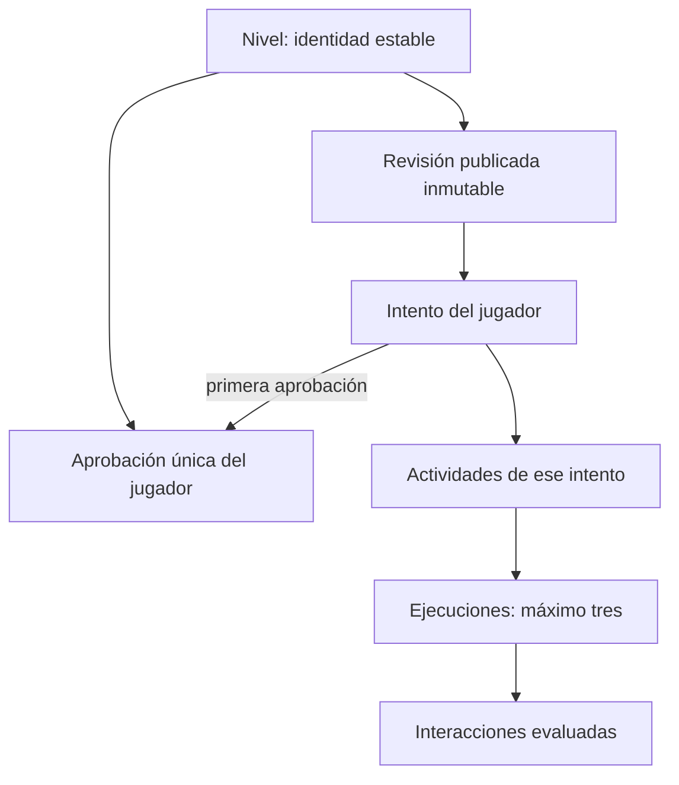

# Criterika — Modelo conceptual de datos

Versión 1.0 · 15 de noviembre de 2026 · Base para revisión

## Propósito y alcance

Este modelo define qué información necesita conservar Criterika, qué significa y qué reglas debe respetar. Se construye desde los acuerdos funcionales y el contrato actual; no recupera los diagramas ER, modelos MongoDB ni scripts SQL descartados.

Fuentes vigentes:

- [Contrato OpenAPI v1](../openapi/criterika_openapi_v1.yaml).
- [Guía del contrato y matriz de operaciones](../openapi/criterika_guia_contrato_v1.md).
- Decisiones funcionales y de privacidad aceptadas en esta conversación.

Criterio de aceptación: una solución funcional, consistente y justificable, con complejidad razonable. No se exige perfección ni se añaden funcionalidades para escenarios ajenos a la primera versión.

**Los 28 conceptos principales que aparecen aquí no equivalen a 28 tablas o colecciones.** Tampoco los 184 schemas HTTP del contrato se convierten en entidades. La elección de motor, representación lógica, claves, índices y estructuras físicas corresponde a las etapas siguientes.

Distinguimos:

- **Conceptos con identidad:** información que debe distinguirse a través del tiempo, como una cuenta, un nivel o un intento.
- **Componentes:** información que tiene sentido dentro de otro concepto, como los criterios de una actividad o las tres etapas de una carta.
- **Datos derivados:** resultados calculables a partir de hechos conservados, como el porcentaje de progreso.
- **Controles técnicos temporales:** sesiones, desafíos, claves de reintento y seguimiento de tareas. Su existencia no introduce nuevas entidades educativas.

## 1. Identidad y acceso

| ID | Concepto | Información esencial | Regla principal |
|---|---|---|---|
| E01 | Cuenta | Identidad estable, correo, hash de contraseña, rol, fechas de alta y uso, datos de perfil necesarios y referencia opcional al avatar. | Correo único entre cuentas vigentes; rol exclusivo JUGADOR o ADMINISTRADOR. |

Nombre, apellidos y fecha de nacimiento son componentes del perfil de la cuenta de jugador. No se introduce otra identidad independiente llamada «usuario», «persona» o «perfil» para representar al mismo jugador. Una posible separación física de esos datos no cambia este significado.

Las tres cuentas administrativas son individuales y predefinidas. El modelo no incluye registro público de administradores ni un configurador de roles y permisos. Una cuenta administrativa no recibe vidas, gemas ni progreso de jugador.

Las sanciones se conservan como hechos separados (E25). El permiso efectivo para jugar se obtiene de sus vigencias, de la situación de cancelación y de la aceptación aplicable. No se mantienen estados contradictorios como «cuenta activa» y «suspensión vigente ignorada».

### Soportes de identidad

| ID | Soporte | Relación y ciclo de vida |
|---|---|---|
| T01 | Sesión | Pertenece a una cuenta. Conserva vigencia absoluta, revocación, control del refresh y confirmación reciente de identidad. Un token de acceso no crea otra cuenta. |
| T02 | Registro pendiente | Todavía no es una cuenta activa. Conserva datos mínimos, hash de contraseña y manifestación provisional de aceptación; caduca como máximo a las 24 horas. |
| T03 | Desafío de verificación | Tiene finalidad explícita: registro, acceso administrativo, recuperación, entrada ARCO o confirmación de nuevo correo. Vigencia, intentos y uso único. No se intercambian desafíos entre finalidades. |

Al verificar un registro se crea una sola cuenta y se vincula la aceptación original, conservando su fecha, IP y documentos reales. La fecha de verificación no sustituye la fecha de aceptación. Si cambiaron los documentos, se solicita una aceptación explícita de la nueva versión; no se atribuye retroactivamente.

Una cuenta puede tener varias sesiones, pero como máximo un intento de nivel activo. Conservar una sesión no garantiza conservar permiso para jugar o gastar.

La inactividad conserva el último uso autenticado iniciado por la persona y el estado del aviso previo. A los 24 meses se avisa con al menos 30 días antes de eliminar. Usar la cuenta durante ese aviso detiene esa eliminación por inactividad; una renovación automática o una tarea del sistema no se considera uso personal. Esto no revoca una solicitud explícita de cancelación del titular. El aviso y sus fechas son componentes del mantenimiento de la cuenta, no otra identidad de usuario.

## 2. Contenido educativo

| ID | Concepto | Información esencial | Regla principal |
|---|---|---|---|
| E02 | Unidad | Identidad, nombre, descripción, posición, disponibilidad y estructura utilizada. | Ordena sus niveles y tiene una carta propia; estructura fija desde el primer intento de cualquiera de sus niveles. |
| E03 | Nivel | Identidad estable, unidad de pertenencia, posición y tipo normal/final. | No cambia de identidad cuando se corrige el contenido. |
| E04 | Revisión de nivel | Composición ordenada, instrucciones, contenido, criterios, tableros aprobados y términos asociados de una publicación. | Una revisión publicada es inmutable; una nueva publicación crea otra revisión. |
| E05 | Actividad | Identidad de un ejercicio programado y nivel al que pertenece. | No se comparte entre niveles; dos actividades del mismo tipo siguen siendo distintas. |
| E06 | Carta | Identidad, unidad, datos de presentación, imagen base y tres etapas de evolución. | Una carta por unidad publicada; evoluciones lineales y únicamente estéticas. |
| E07 | Término educativo | Identidad, nombre, categoría, definición, ejemplo, fuente y disponibilidad. | Puede asociarse a varios niveles; su corrección no elimina adquisiciones existentes. |
| E08 | Archivo | Identidad, tipo de contenido validado, tamaño, ubicación protegida, uso autorizado y referencias que justifican conservarlo. | Conocer su identificador no concede permiso de lectura. |

El camino es único: se representa mediante el orden de unidades. No necesita una identidad de negocio adicional mientras Criterika no permita varios caminos.

### Componentes del contenido

| Componente | Pertenece a | Definición |
|---|---|---|
| Definición publicada de actividad | Revisión de nivel | Identidad de actividad, tipo, posición, instrucciones, contenido y criterio correspondientes a esa revisión. |
| Criterio de aprobación | Definición de actividad | Umbral o límite válido para su tipo; el jugador recibe ese criterio concreto. |
| Contenido del minijuego | Definición de actividad | Parejas, preguntas/opciones/soluciones, asociaciones o palabras y pistas, según el tipo. |
| Distribución aprobada | Contenido de sopa o crucigrama | Dimensiones, casillas, ubicaciones y orientaciones necesarias para reproducir el tablero. |
| Etapa de evolución | Carta | Número 1, 2 o 3, imagen propia y disponibilidad. La base pertenece directamente a la carta. |
| Estado de publicación | Catálogo correspondiente | Borrador, publicado o deshabilitado; disponibilidad no equivale a adquisición del jugador. |

No se construye un catálogo editable de «tipos de minijuego»: hay cinco tipos fijos. Tampoco se crea un árbol genérico de evoluciones o un sistema de acabados; existen tres etapas consecutivas.

Un borrador puede estar incompleto. Una revisión publicable contiene de tres a seis actividades, máximo dos por tipo, posiciones únicas y contenido válido. Solo pueden publicarse tableros generados y revisados que tengan solución válida; las palabras de un crucigrama forman un conjunto conectado.

Una unidad publicada tiene al menos un nivel y exactamente un final al terminar. Su carta requiere imagen base y tres imágenes distintas de evolución. Antes del primer uso puede corregirse su estructura; después se corrige contenido mediante revisiones y se añaden unidades al final del camino.

Las imágenes de cartas y etapas bloqueadas no se entregan al jugador. Los archivos de avatar y de acreditación de identidad son privados por su finalidad. El contenido de un documento legal de la aplicación (E21) no se confunde con los términos educativos (E07), aunque el curso trate leyes o normas.

## 3. Participación y progreso

| ID | Concepto | Información esencial | Regla principal |
|---|---|---|---|
| E09 | Intento de nivel | Jugador, nivel, revisión utilizada, condiciones fijadas, inicio, última comunicación, estado, motivo y resultado final. | Una participación completa y un único resultado terminal. |
| E10 | Actividad en el intento | Actividad programada, posición inicial, estado, número de ejecuciones y posición entre pendientes. | Su estado pertenece a ese intento; no se guarda en el catálogo compartido. |
| E11 | Ejecución de actividad | Actividad del intento, número 1–3, respuestas, errores, resultado y fechas. | Cada recuperación es una ejecución nueva; no sobrescribe la anterior. |
| E12 | Interacción evaluada | Ejecución, acción confirmada, respuesta propia, evaluación del servidor, fecha y referencia de la intención procesada. | Un reintento de red no crea otro error o avance. |
| E13 | Aprobación de nivel | Jugador, nivel, primer intento aprobado que la origina, fecha y concesión inicial correspondiente. | Como máximo una por jugador y nivel. |

### Cómo conservar el contenido con el que se jugó

El nivel conserva una identidad estable y tiene revisiones publicadas. Cada intento utiliza una revisión concreta, que no se modifica durante su ejecución. No es necesario introducir simultáneamente un historial universal de eventos y revisiones independientes para cada campo.

El intento conserva además sus condiciones propias: recompensa aplicable, derecho a carta/términos, zona horaria del dispositivo al inicio y cualquier orden de presentación que se haya sorteado. Puede referenciar contenido publicado inmutable; no se exige copiar indiscriminadamente todo el catálogo en cada respuesta o ejecución.

Una revisión utilizada por un intento conservado no se elimina dejando ese intento sin explicación. Retirar una actividad del borrador no borra sus respuestas históricas. Al suprimir una cuenta se eliminan sus intentos y respuestas; las revisiones educativas compartidas no se eliminan por pertenecer a otros jugadores también.

Las flechas muestran vínculos conceptuales, no ubicación física de datos.

### Estados y reglas

- El intento está EN_CURSO, APROBADO, FALLIDO, ABANDONADO o CANCELADO. Un resultado final no vuelve a EN_CURSO.
- Se aprueba al superar todas las actividades iniciales. El tercer fallo de una actividad termina el intento completo.
- Un fallo recuperable agrega la misma actividad al final de pendientes, sin duplicarla. Superarla la retira.
- Una actividad tiene como máximo tres ejecuciones; los errores internos se reinician en cada una.
- Ninguna actividad del catálogo contiene «errores del jugador» o «intentos utilizados».
- Las selecciones temporales y movimientos del cursor no requieren historial. Se conservan las interacciones que el servidor evalúa.
- Aprobar un intento de práctica no crea una segunda aprobación E13 ni una segunda recompensa inicial.
- Fallar una práctica no elimina una aprobación anterior.
- La primera aprobación del nivel final completa la unidad cuando se han cumplido sus requisitos; no basta aprobar una actividad suelta.

### Cardinalidades principales

| Relación | Cardinalidad y condición |
|---|---|
| Cuenta de jugador → intentos | Cero o muchos históricos; como máximo uno activo. |
| Unidad → niveles | Cero o muchos en borrador; uno o más al publicar; cada nivel pertenece a una unidad. |
| Nivel → revisiones publicadas | Cero o muchas; cada revisión corresponde a un nivel. |
| Nivel → actividades | Cero o muchas identidades históricas; una revisión publicada utiliza entre tres y seis. |
| Revisión → intentos | Cero o muchos; cada intento utiliza una sola revisión. |
| Intento → actividades del intento | Exactamente las tres a seis fijadas al comenzar. |
| Actividad del intento → ejecuciones | Cero si aún no comenzó; una a tres cuando se ejecuta. |
| Ejecución → interacciones evaluadas | Cero o muchas, cada una perteneciente a una ejecución. |
| Jugador + nivel → aprobación | Cero o una; procede de un intento propio aprobado. |
| Nivel → aprobaciones de jugadores | Cero o muchas; no convierte al nivel en un dato privado del jugador. |

## 4. Gamificación y adquisiciones

| ID | Concepto | Información esencial | Regla principal |
|---|---|---|---|
| E14 | Estado del jugador | Estado de vidas y regeneración; información necesaria para racha; saldos o resúmenes materializados si se necesitan. | Uno por cuenta de jugador; no aplica a administradores. |
| E15 | Movimiento de gemas | Jugador, cantidad con signo, causa concreta, fecha y operación de origen. | Cada cambio de gemas tiene una causa; una corrección agrega un movimiento, no reescribe el anterior. |
| E16 | Compra de vidas | Jugador, paquete elegido, vidas entregadas, gemas gastadas, fecha y movimiento asociado. | Compra completa o rechazo sin efectos; no pagos reales. |
| E17 | Carta obtenida | Jugador, carta, aprobación de nivel final de origen y fecha. | Una adquisición base por jugador y carta. |
| E18 | Evolución obtenida | Jugador, carta obtenida, etapa, fecha, costo aplicado y movimiento de gemas. | Una por etapa; requiere base y etapa anterior. |
| E19 | Término desbloqueado | Jugador, término, aprobación que lo desbloqueó y fecha. | Un desbloqueo por jugador y término, aunque se relacione con varios niveles. |
| E20 | Corrección administrativa | Cambio comprobado de gemas, XP, vidas o reconstrucción de progreso, motivo, fecha y referencia al caso/evidencia. | Conserva el efecto de negocio independientemente de que la bitácora de auditoría llegue a su vencimiento. |

### Gemas, XP y recompensa inicial

La aprobación E13 conserva la concesión inicial y su origen. El movimiento E15 conserva el efecto monetario en gemas. No son dos saldos competidores: uno acredita el hecho educativo y el otro explica la entrada o salida de gemas.

Reglas de reconciliación:

- Gemas: suma de movimientos confirmados, con saldo inicial cero.
- XP: suma de XP de primeras aprobaciones más correcciones de XP confirmadas, con valor inicial cero.
- Un saldo actual puede materializarse para lectura/operación; debe coincidir con esos hechos y actualizarse conjuntamente con ellos.
- Las correcciones de XP no dependen exclusivamente de la bitácora de 180 días. Su efecto necesario para explicar el total se conserva como dato de negocio mientras corresponda.
- No se construye un historial universal de todos los eventos de la aplicación. Solo se conservan los hechos que justifican saldos, resultados y adquisiciones.
- La primera recompensa es única por jugador/nivel, incluso si caduca la caché técnica de reintentos o se publica otra revisión.

Políticas fijas de primera versión:

| Política | Valores |
|---|---|
| Nivel normal | 150 gemas y 100 XP. |
| Nivel final | 300 gemas y 250 XP, más carta; sustituye la recompensa normal. |
| Paquetes de vidas | Una por 100; tres por 150; cinco por 250 gemas. |
| Evoluciones | Etapas 1/2/3 por 150/350/500 gemas. |

No se necesitan conceptos de negocio independientes para catálogos editables de precios, niveles de jugador por XP, dinero real, suscripciones o transferencias entre jugadores. Los importes aplicados sí quedan registrados en cada operación.

### Vidas y regeneración

La cantidad total de vidas y la referencia temporal de regeneración son estado primario del jugador. La reserva se vincula al intento activo; no es otra clase de vida ni otro inventario.

Reglas:

1. Vidas totales = vidas disponibles + vidas reservadas.
2. Totales entre cero y cinco; reservadas entre cero y uno.
3. Un intento activo tiene una reserva; un intento terminado ya no la tiene.
4. Reservar no reduce totales ni inicia regeneración.
5. Fallar o abandonar consume la reserva una sola vez; aprobar o cancelar la libera.
6. Las vidas disponibles se calculan restando la reserva a las totales; no se mantienen como un tercer contador autónomo.
7. La referencia temporal permite calcular la regeneración por intervalos de 60 minutos hasta el máximo. No se guarda un registro nuevo por cada segundo ni se exige una entidad por cada vida regenerada.
8. Compra, pérdida, ajuste o reserva confirman el estado efectivo a la hora del servidor antes de modificarlo. Si se alcanza cinco, se detiene la cuenta regresiva; no se acumula tiempo sobrante.

Ejemplo: al iniciar con cinco, quedan cinco totales, cuatro disponibles y una reservada. Un paquete de una vida se rechaza porque la reserva cuenta para el máximo. Al fallar quedan cuatro totales, cuatro disponibles y cero reservadas.

### Racha

La racha conserva su último hito acreditado: fecha local, zona aplicada y cantidad consecutiva alcanzada. Las aprobaciones de intentos —incluidas las prácticas— permiten explicar esos hitos.

El cálculo utiliza el instante de aprobación del servidor y la zona IANA fijada al iniciar el intento. Un día local ya acreditado no suma; el inmediato siguiente continúa; un salto comienza en uno. Una fecha anterior causada por cambio de zona no retrocede el último día ni suma un día adicional.

El contador del último hito no debe mostrarse como racha vigente indefinidamente: si ya se omitió un día según la zona de referencia, la consulta muestra racha efectiva cero hasta una nueva aprobación. El hito histórico permanece para explicar el cálculo. No se necesita una entidad genérica «premio de racha» porque no existe esa recompensa en v1.

### Adquisiciones y cambios de catálogo

La posesión de una carta, evolución o término pertenece al jugador, no al estado de publicación del catálogo. Deshabilitar el catálogo no destruye esa posesión.

Etapa actual de carta se obtiene de sus adquisiciones consecutivas; no se permite tener la tercera sin las dos anteriores. La carta base no se compra: la concede la primera aprobación del final de su unidad.

Los términos de una primera aprobación corresponden a los fijados en ese intento. Asociar después otro término a un nivel ya completado no reabre la primera recompensa ni concede desbloqueos retroactivos. Para ofrecer ese término como nuevo desbloqueo a jugadores anteriores, puede asociarse a un nivel de una nueva unidad que aún no completen. Corregir la definición de un término ya adquirido sí actualiza su consulta.

## 5. Privacidad, administración y auditoría

| ID | Concepto | Información esencial | Regla principal |
|---|---|---|---|
| E21 | Versión de documento legal | Tipo términos/aviso, versión, contenido publicado, fecha, huella de integridad, finalidades y necesidad de nueva aceptación. | Publicada no se sobrescribe. No es un término del diccionario educativo. |
| E22 | Evidencia de aceptación | Cuenta, documentos realmente presentados, manifestaciones específicas, finalidades consentidas, fecha/hora e IP obtenidas por servidor. | Puede haber muchas evidencias históricas; una nueva no sustituye las anteriores. |
| E23 | Solicitud de privacidad | Folio, solicitante y canal, titular identificado cuando corresponda, derecho/alcance, datos solicitados, evidencias, identidad, comunicaciones, plazos y resolución. | Puede existir sin una cuenta vinculada o ser presentada por representante. |
| E24 | Ejecución de privacidad | Solicitud y resolución de origen, acciones aprobadas, inicio, avances, pendientes, errores y terminación. | No declara completado un borrado con pasos pendientes. |
| E25 | Sanción | Jugador, tipo, motivo, inicio, vencimiento si temporal, aplicación y levantamiento/revisión. | La vigencia se calcula con reloj del servidor; vencer una no levanta otra. |
| E26 | Evento de auditoría | Autor, acción, recurso, instante UTC, campos afectados y cambios permitidos, motivo y correlación. | Se registra junto con el cambio administrativo; no editable por administradores del panel. |
| E27 | Caso de revisión | Inconsistencia detectada, evidencia mínima, jugador afectado si corresponde, estado y resolución/correcciones relacionadas. | Detectar no modifica automáticamente saldos ni sanciona. |
| E28 | Control de eliminación | Referencia técnica mínima al sujeto eliminado, fecha de eliminación y vencimiento. | Permite reaplicar supresión al restaurar; sobrevive a la cuenta eliminada durante su plazo técnico y no se considera anónimo. |

### Relaciones y significado

| Relación | Cardinalidad y condición |
|---|---|
| Unidad → carta | Cero o una en borrador; exactamente una válida para publicación. Cada carta corresponde a una unidad. |
| Carta → etapas | Tres posiciones numeradas al publicar; cada una tiene imagen propia. |
| Cuenta → estado del jugador | Uno para JUGADOR; ninguno para ADMINISTRADOR. |
| Jugador → movimientos/compras | Cero o muchos; cada operación corresponde a un jugador. |
| Compra de vidas → movimiento de gemas | Un débito correspondiente a la compra confirmada. |
| Evolución obtenida → movimiento de gemas | Un débito correspondiente a ese desbloqueo confirmado. |
| Aprobación → recompensa inicial | Una concesión con efectos únicos; términos sin duplicados y carta solo si corresponde. |
| Jugador + carta → carta obtenida | Cero o una. |
| Carta obtenida + etapa → evolución obtenida | Cero o una por etapa y en orden. |
| Jugador + término → desbloqueo | Cero o uno. |
| Cuenta → evidencias de aceptación | Cero o muchas; al completar registro se exige la evidencia vigente correspondiente. |
| Evidencia → documentos | Una versión de términos y una de aviso, más finalidades específicas. Una versión puede estar referenciada por muchas evidencias. |
| Cuenta → solicitudes de privacidad | Cero o muchas; la relación con cuenta puede ser desconocida inicialmente o retirarse al eliminarla. |
| Solicitud → ejecuciones | Cero o muchas operaciones justificadas; no repetir un efecto ya aplicado. |
| Solicitud → acreditación/comunicaciones/resolución | Componentes de ese expediente, no otros usuarios o cuentas obligatorios. |
| Jugador → sanciones | Cero o muchas; una temporal tiene fecha de vencimiento y un bloqueo no vence automáticamente. |
| Administrador → eventos de auditoría | Cero o muchos; el actor de mantenimiento/sistema se identifica como tal, no se atribuye a un administrador ficticio. |
| Caso de revisión → correcciones | Cero o muchas; cada corrección conserva su causa y no sobrescribe movimientos previos. |
| Eliminación → control de eliminación | Referencia restringida sin exigir que la cuenta borrada siga existiendo. No es una cuenta en soft delete indefinido. |

### Auditoría y efectos de negocio

La bitácora E26 responde quién cambió qué y cuándo. Los movimientos E15 y las correcciones E20 explican por qué existe el saldo/progreso actual. No se utiliza la bitácora temporal como único lugar para conservar un efecto que seguirá siendo necesario después de 180 días.

Cada cambio administrativo se confirma conjuntamente con su evidencia. Si no puede registrarse auditoría, el cambio no se confirma. Los tres administradores usan sus propias cuentas. La intervención excepcional directa se identifica y audita con permisos de mantenimiento; no existe un camino manual sin traza autorizado por el modelo.

No se copian perfiles completos, documentos de identidad, claves, tokens o contraseñas a auditoría. Los datos anteriores/posteriores se limitan a lo necesario y permitido. Si basta saber que cambió el correo, se guarda el nombre del campo y la referencia restringida necesaria, no ambos correos en texto libre indiscriminado.

Al eliminar una cuenta se revisan también identificadores indirectos, referencias de recursos, motivos y copias de datos dentro de auditoría, casos, correcciones y cachés. Si una supuesta anonimización todavía permite identificar al jugador, se suprime esa información o se conserva únicamente bajo un bloqueo específico justificado.

### Solicitante, titular y cuenta son distintos

Una persona puede solicitar derechos sin poder iniciar sesión. También puede actuar como representante. Por ello, E23 conserva información del solicitante y del canal para el trámite sin inventar una cuenta nueva ni asumir que quien controla un correo es el titular de una cuenta.

El canal alternativo verificado permite folio/estado mínimo. La entrega de información personal o una modificación procedente exige acreditación proporcional de identidad y, cuando corresponda, representación. La vinculación a una cuenta se establece tras esa comprobación.

El expediente distingue solicitud recibida, identidad comprobada, resolución, bloqueo cuando corresponda y ejecución completa. Un acceso restringido o una sesión revocada no prueba que ya se hayan borrado todos los datos.

El responsable real, las bases de conservación y el calendario aplicable son configuración/documentación operativa necesaria antes de admitir datos reales. Este modelo no inventa una retención legal universal ni acredita cumplimiento jurídico por sí solo.

## 6. Qué conservar y qué calcular

| Información | Clasificación | Decisión |
|---|---|---|
| Identidad, correo y datos necesarios de perfil | Primaria | Conservar con acceso restringido; credencial mediante hash. |
| Revisión publicada utilizada | Primaria histórica | Conservar inmutable mientras tenga referencias necesarias. |
| Respuestas y resultados evaluados | Primaria histórica | Conservar dentro del intento/ejecución y atender exportación o supresión. |
| Primera aprobación y concesión inicial | Hecho de negocio | Conservar unicidad independiente de caché de reintentos. |
| Movimientos de gemas y correcciones efectivas de XP | Hechos de negocio | Permiten reconciliar valores actuales. |
| Saldo actual de gemas y XP | Derivado, materializable | Debe coincidir con hechos; no es otra fuente independiente. |
| Vidas totales y referencia de regeneración | Estado primario temporal | Necesarios para calcular el estado efectivo en cualquier instante. |
| Vida reservada | Vínculo del intento activo | Como máximo una; no otro inventario ni compra. |
| Vidas disponibles | Derivada | Totales efectivas menos reserva. |
| Última comunicación de intento | Estado técnico actual | Actualizar referencia temporal; no registrar cada heartbeat como evento histórico. |
| Orden de pendientes y actividad actual | Estado del intento | Mantener consistente con resultados; no copiarlo al catálogo compartido. |
| Progreso de unidad/camino | Derivado | A partir de primeras aprobaciones y estructura fija; sin contadores autónomos contradictorios. |
| Porcentaje de un intento | Derivado | Actividades iniciales distintas superadas / total inicial. Recuperaciones no aumentan denominador. |
| Etapa actual de carta | Derivada | Mayor etapa consecutiva obtenida, no otro desbloqueo. |
| Racha | Hito conservado + cálculo temporal | Mantener último hito y calcular vigencia al consultar. |
| Permiso efectivo por sanción | Derivado de vigencias | No depende de que cron borre o cambie un estado a tiempo. |
| Disponibilidad de compra | Derivada | Publicación, requisitos, saldo, vidas y permisos actuales; revalidar al confirmar. |
| Registro de aceptación e IP | Evidencia primaria | Conservar versiones y acción real; no reconstruir IP a partir de logs. |
| Exportación JSON | Resultado de consulta | Generar sin crear copia pública o archivo persistente por defecto. |
| Tema claro/oscuro | Preferencia local | No requiere persistencia en servidor. |

Materializar un valor significa conservarlo como resumen para operar/consultar, con una única regla de actualización y reconciliación. No obliga a escoger aquí una tecnología o arquitectura especial.

## 7. Conservación y eliminación

| Grupo | Necesidad/ciclo | Tratamiento al cancelar |
|---|---|---|
| Cuenta, estado, progreso, intentos y respuestas | Mientras exista la relación funcional y sean necesarios. | Retirar del uso ordinario; suprimir o bloquear solo lo específicamente justificado. |
| Compras, movimientos y correcciones del jugador | Explican sus saldos y adquisiciones durante la relación. | No conservar indefinidamente solo por ser «historial»; alcanzar la misma supresión/bloqueo aplicable. |
| Sesiones, desafíos y registros pendientes | Vigencia técnica limitada. | Revocar y depurar; retirar también copias y cachés vinculadas. |
| Evidencias de aceptación con IP | Relación y eventual bloqueo justificado. | Supresión cuando termine la necesidad/fundamento; no anonimizar simplemente cambiando el nombre. |
| Versiones de documentos legales | Referencia del texto publicado sin datos del jugador. | Pueden conservarse sin conservar quién aceptó, cuando proceda borrar esa vinculación. |
| Catálogo y revisiones educativas | Necesidad de publicación e historia compartida. | No se borran por eliminar a un jugador; revisar medios personales si existieran. |
| Solicitudes, resoluciones y evidencias de identidad | Necesidad del trámite; conservación excepcional fundamentada si aplica. | Preservar solo lo necesario para terminar/notificar, con vencimiento; no crear archivo de identidad permanente. |
| Adjuntos de acreditación | Necesidad estricta; como máximo 30 días después del cierre salvo bloqueo fundado. | Eliminar archivos, copias y referencias cuando termine esa necesidad. |
| Auditoría administrativa | Política técnica máxima de 180 días desde evento. | Retirar datos/vínculos del jugador antes si corresponde su cancelación; no esperar siempre los 180 días. |
| Logs técnicos depurados | Política técnica máxima de 30 días. | No deben contener PII innecesaria ni secretos; revisar cualquier filtración detectada. |
| Respaldos propios | Antigüedad máxima de 30 días. | Expiración/supresión controlada y reaplicación de eliminaciones antes de restaurar uso. |
| Control de eliminaciones | 60 días desde eliminación según política técnica. | Identificador técnico mínimo protegido, no anónimo; vence sin reiniciar plazo al restaurar. |

Los máximos técnicos son techos, no autorizaciones para conservar información que ya no necesita conservarse. No sustituyen los plazos aplicables a un expediente concreto.

**Regla necesaria de ejecución:** al planificar una cancelación, contrastar su vencimiento con la expiración real de respaldos y la respuesta de terceros. El máximo de 30 días de respaldos no debe utilizarse automáticamente si rebasa el plazo aplicable. Deben configurarse retenciones más cortas o un mecanismo de supresión que permita cumplirlo. Una ejecución sigue pendiente si quedan copias o pasos sin resolver; no se declara cumplimiento solo porque se desactivó la cuenta.

Esta regla se llevará a la selección/configuración de almacenamiento y proveedores. El modelo ya conserva fechas, fundamento, pendientes y evidencia del resultado; no presupone que todos los servicios permitan el mismo borrado.

## 8. Controles técnicos que apoyan el modelo

| ID | Soporte | Información mínima y límite |
|---|---|---|
| T01 | Sesión | Cuenta, vigencia absoluta, revocación, control de refresh y confirmación reciente. Jugador 30 días; administrador ocho horas. |
| T02 | Registro pendiente | Datos mínimos, hash, evidencia provisional y fecha de vencimiento; máximo 24 horas. |
| T03 | Desafío por finalidad | Referencia al trámite, verificador seguro, vencimiento, intentos y uso; códigos diez minutos/cinco intentos y reenvío a partir de 60 segundos. |
| T04 | Control de idempotencia | Actor/sesión, operación, clave, huella protegida y resultado recuperable. 24 horas; respuestas con tokens solo cinco minutos cifradas. No equivale a primera aprobación ni a una compra. |
| T05 | Estado de tarea | Última ejecución/éxito, estado, pendientes y error sanitizado de intentos, depuración, inconsistencias, inactividad o eliminación. No almacena payloads personales en logs. |

Un recibo de compra y un movimiento de gemas permanecen hechos de negocio aunque venza T04. La garantía técnica de recuperar una respuesta no dura indefinidamente: después de esa ventana se consulta el recibo/movimiento, en lugar de reenviar a ciegas una compra como nueva intención.

Después de verificar el correo de entrada ARCO, se emite una credencial limitada de 30 minutos vinculada al trámite/correo. Es un soporte de T03, no una sesión T01 de cuenta ni una prueba suficiente de identidad del titular. Solo permite crear solicitudes y consultar folios/estado mínimo de ese canal.

La reserva de una vida y la primera recompensa no dependen de que T04 siga existiendo. Sus propias reglas de unicidad y estado evitan duplicaciones.

Estos controles no añaden un modelo alterno de negocio, ni requieren varias bases de datos o una tecnología de caché determinada.

## 9. Procesos críticos contrastados con el modelo

### A. Aprobar un nivel por primera vez

1. E09 identifica cuenta, nivel y revisión; E10–E12 acreditan todas las actividades superadas.
2. Se confirma un único resultado APROBADO y se libera la reserva.
3. Se crea E13 solo si aún no existe aprobación de ese jugador/nivel.
4. La concesión inicial crea el movimiento positivo E15, XP correspondiente y adquisiciones E17/E19 que correspondan, sin duplicados.
5. Se actualizan resúmenes y racha conjuntamente con los hechos que justifican la aprobación.

Si se pierde la respuesta de red, consultar E09 devuelve el resultado. Repetir la solicitud no crea otra aprobación ni otro premio. En una práctica aprobada se actualiza racha, pero no se repite el paso de recompensa inicial.

### B. Comprar un paquete de vidas

1. El servidor calcula vidas efectivas de E14 y reserva de E09; comprueba permisos y saldo.
2. Valida que el paquete completo quepa dentro de cinco, incluida la reserva.
3. Confirma juntos E16, débito E15 y actualización de vidas/regeneración.
4. Si algo no puede confirmarse, no queda débito sin vidas ni vidas sin débito.

Ejemplo: cuatro disponibles y una reservada son cinco totales; ningún paquete cabe. Dos disponibles, ninguna reservada y paquete de tres producen cinco totales y detienen regeneración.

### C. Evolucionar una carta

1. Verifica E17, etapa anterior E18, disponibilidad de carta/etapa y saldo.
2. Confirma juntos nueva E18 y débito E15 por 150, 350 o 500 gemas.
3. La restricción jugador/carta/etapa impide duplicar adquisición. Rechazar una etapa fuera de secuencia no consume gemas.

No hay que crear otra carta base para representar cada evolución; la adquisición pertenece a la misma carta.

### D. Corregir contenido mientras se juega

1. El administrador edita borrador; el cambio y E26 se confirman juntos.
2. Publica otra E04 tras validar composición y tableros.
3. El intento abierto sigue vinculado a la revisión anterior; nuevos intentos usan la nueva.
4. La aprobación sigue identificada por E03, no por revisión, nombre o posición; no se puede volver a cobrar el premio inicial por una corrección.

### E. Suspender una cuenta durante un intento

1. Se confirma E25 y su E26 con autor real, motivo e inicio/vencimiento.
2. Se cancela el intento activo con motivo de sanción, sin consumir reserva y sin premio.
3. Las sesiones pueden seguir sirviendo para consultas propias permitidas y privacidad, pero no para jugar o gastar.
4. Vencer o levantar la sanción no revive el intento cancelado ni levanta otra sanción independiente.

### F. Cancelar una cuenta y restaurar un respaldo posteriormente

1. E23 conserva petición y comprobación de identidad; se restringe uso ordinario y revocan T01.
2. Se resuelve alcance y eventual bloqueo con fundamento y vencimiento.
3. E24 controla supresión operativa, archivos, terceros y respaldos; la vida de un intento cancelado no se consume.
4. E28 conserva referencia técnica mínima necesaria para reaplicar eliminación; no requiere conservar la cuenta como activa o en soft delete perpetuo.
5. Se revisan también auditoría, correcciones, expedientes, miniaturas y cachés para retirar vínculos personales innecesarios.
6. Al restaurar, se reaplican E28 y los vencimientos antes de reabrir el servicio. Restaurar no reinicia retenciones.
7. E24 solo termina al completar los pasos aplicables. El canal de privacidad no reactiva una cuenta borrada para informar estado mínimo del trámite.

## 10. Cobertura funcional respecto al contrato

| Operaciones del API | Conceptos que las sostienen | Representaciones HTTP que no se convierten en entidades |
|---|---|---|
| Registro, verificación, login, refresh, logout y confirmación reciente | E01, E22 y T01–T04. | Tokens, Challenge, mensajes de acuse y respuestas de sesión. |
| Perfil, avatar y sesiones propias | E01, E08, T01. | UserProfile, MediaInfo y páginas de sesiones. |
| Documentos legales y nuevas aceptaciones | E21, E22. | CurrentLegalDocuments y sus DTO de entrada/salida. |
| Camino, vista previa y progreso | E02–E07, E13, E17–E19. | LearningPath, LevelPreview, ProgressSummary y porcentajes. |
| Inicio, heartbeat, consulta, abandono y respuestas de juego | E04, E09–E14, T04–T05. | PlayableExecution, GameAnswer, GameFeedback, Heartbeat y GameActionResult. |
| Economía, movimientos, tienda y recibos | E13–E16, E20. | Economy, Lives, LifePackages y disponibilidad de paquete. |
| Colección, compras de evolución y diccionario | E06–E08, E15, E17–E19. | CardView, EvolutionView y términos filtrados por desbloqueo. |
| Edición, reordenación, publicación y generación de tableros | E02–E08, E26. | ETag, borradores devueltos y vistas previas de generación. |
| Consulta administrativa de jugadores y correcciones | E01, E13–E20, E26–E27. | AdminPlayer y respuestas de ajuste/restauración. |
| Sanciones, panel y casos de revisión | E25–E27, T05. | Dashboard, conteos y alertas próximas a vencer. |
| Exportación, ARCO, canal alternativo y acreditación | E01, E08, E21–E24, T03. | PersonalDataExport, folios/estado externo y token de entrada limitado. |
| Resolución/ejecución de privacidad y cambio de correo aprobado | E23–E24, E28, T03, E26. | Estado de ejecución, mensajes y respuesta de confirmación. |
| Auditoría, tareas y acceso a medios | E08, E26, E28, T05. | Páginas de eventos, MaintenanceStatus y transmisión de archivos. |
| Salud pública del servicio | Ningún concepto de negocio nuevo. | Respuesta de disponibilidad mínima. |

La cobertura se revisa por proceso. El número de rutas o schemas no determina el número de entidades.

## 11. Reglas de integridad que deberá sostener el modelo lógico

1. Una cuenta tiene un rol exclusivo; solo un jugador tiene estado de juego.
2. Un correo de cuenta vigente no identifica dos cuentas distintas.
3. Cada nivel pertenece a una unidad; cada actividad a un nivel.
4. La unidad publicada tiene final único al terminar y carta válida; estructura fija desde primer uso.
5. Una revisión publicada válida contiene de tres a seis actividades distintas y máximo dos por tipo.
6. Revisión publicada e intentos existentes no cambian por editar borradores.
7. Un jugador tiene como máximo un intento activo y una reserva de vida.
8. Cada actividad de un intento tiene como máximo tres ejecuciones y una posición coherente entre pendientes.
9. Un resultado terminal de intento se confirma una vez; ninguna respuesta tardía lo revierte.
10. Primera aprobación y recompensa inicial son únicas por jugador/nivel, no por revisión.
11. Todo movimiento de gemas tiene causa; los saldos no son negativos.
12. Compra o evolución y su débito se confirman conjuntamente.
13. Vidas totales incluyen reserva y nunca superan cinco; disponibles se derivan sin doble contador autónomo.
14. Las etapas obtenidas son consecutivas y no se duplican por jugador/carta/etapa.
15. Deshabilitar contenido no retira adquisiciones ni progreso previo.
16. Un término se desbloquea una vez por jugador; las definiciones corregidas conservan su identidad.
17. La sanción efectiva se obtiene por vigencia; no depende de eliminación cron.
18. Toda escritura administrativa tiene evidencia de autor/cambio; mantenimiento se identifica por separado.
19. El vencimiento de auditoría no borra un efecto de negocio necesario para explicar saldos/progreso.
20. Una aceptación referencia los documentos y finalidades reales; IP e instante no los declara el cliente.
21. Controlar correo para entrada ARCO no sustituye acreditar identidad o representación.
22. Supresión no termina mientras queden pasos aplicables pendientes; bloqueos tienen fundamento y vencimiento.
23. El control de eliminación sobrevive de forma limitada sin exigir conservar la cuenta; restauración no lo retrocede.
24. Los resúmenes derivados se actualizan/reconcilian con sus hechos y no compiten como verdades independientes.

Estas son obligaciones conceptuales. Algunas podrán expresarse como restricciones de almacenamiento y otras requerirán operaciones coordinadas en el servicio. Su reparto se decidirá en el modelo lógico, según el motor elegido.

## Resultado y siguiente etapa

El modelo distingue identidad, contenido editable, participación histórica, hechos económicos, adquisiciones y privacidad sin duplicar un concepto por cada DTO. Los procesos críticos tienen origen, resultado y reglas de unicidad/conservación identificables.

No se ha seleccionado motor ni diseñado un esquema físico. La siguiente etapa será elegir un motor principal a partir de estas necesidades y construir un único modelo lógico coherente con él, verificando las 24 reglas de integridad y los procesos críticos antes de generar scripts.
