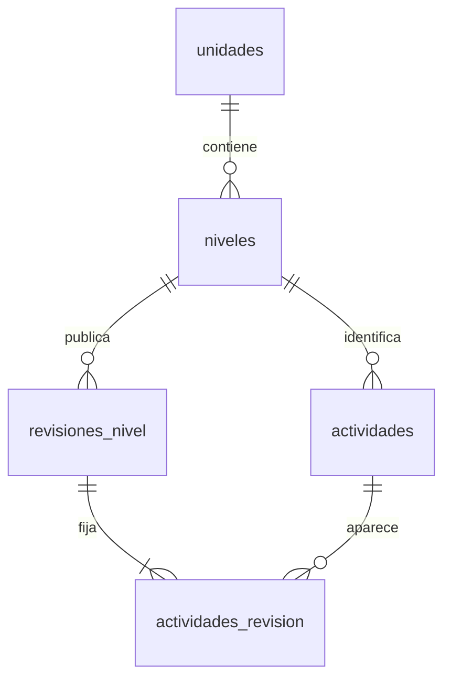
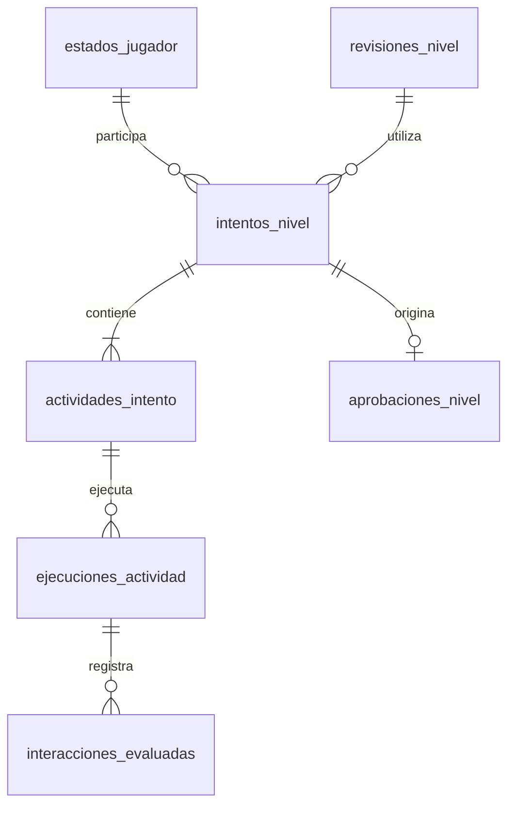

# Criterika — Selección de motor y modelo lógico relacional

Versión 1.0 · 15 de noviembre de 2026 · Especificación para revisión e implementación

## 1. Decisión

**Se elige PostgreSQL como motor principal.** PostgreSQL 18 es la referencia técnica consultada; la versión menor soportada y el alojamiento se fijarán al preparar el despliegue. No se presupone que ya exista un servidor ni que una versión esté disponible en un proveedor/región concretos.

El motivo es la forma del problema: Criterika debe preservar relaciones entre cuentas, niveles, intentos, aprobaciones y adquisiciones; coordinar saldo, compra y beneficio; y registrar cambios administrativos con su evidencia. Es una decisión de adecuación al proyecto, no una afirmación de que otro motor sea incapaz de hacerlo.

PostgreSQL ofrece claves y restricciones relacionales, unicidad parcial y bloqueo de filas para coordinar estas operaciones. La selección aprovecha esas capacidades sin exigir una arquitectura distribuida. MongoDB también ofrece transacciones multidocumento; no se descarta por una supuesta ausencia de atomicidad, sino porque aquí resulta más directo expresar las relaciones e invariantes con un modelo relacional único.

Referencias oficiales usadas para esta decisión:

- [PostgreSQL: restricciones](https://www.postgresql.org/docs/current/ddl-constraints.html).
- [PostgreSQL: bloqueos de filas](https://www.postgresql.org/docs/current/explicit-locking.html).
- [PostgreSQL: JSON y JSONB](https://www.postgresql.org/docs/current/datatype-json.html).
- [MongoDB: atomicidad y transacciones](https://www.mongodb.com/docs/manual/core/write-operations-atomicity/).

## 2. Alcance de esta etapa

Se traduce el [modelo conceptual](criterika_modelo_conceptual_v1.md) a relaciones, atributos, claves y reglas, contrastadas con el contrato OpenAPI.

El resultado son **53 tablas lógicas**, incluidas asociaciones y soportes temporales, y **88 relaciones FK propuestas**. No son 53 funcionalidades adicionales: se representan las 28 identidades/conceptos del dominio, sus asociaciones y los cinco soportes técnicos ya identificados. Tampoco son 142 tablas derivadas de las 142 operaciones del API.

Esta entrega no contiene DDL ejecutable, migraciones, cuentas reales de administrador, conexión a nube ni una base ya desplegada. Las validaciones reportadas revisan la especificación; las transacciones deberán probarse contra PostgreSQL cuando se implemente el modelo físico.

### Convenciones

- Nombres de tablas y columnas en español; los IDs del API siguen siendo UUID.
- PK: identifica una fila. UQ: combinación que no puede duplicarse. FK: relación verificable con una clave existente. CHECK: regla sobre la fila actual.
- `timestamptz` representa instantes y se serializa en UTC; la zona IANA del jugador se conserva aparte cuando es necesaria.
- `NULL` significa ausencia permitida, no cadena vacía. En UQ ordinarias, varios NULL no representan varios orígenes presentes; los orígenes monetarios usan además CHECK de exclusividad.
- Versiones de concurrencia (`version`/ETag) y números de revisión publicada son conceptos distintos.
- Tablas de catálogo y revisión no se suprimen por eliminar un jugador. Los datos privados del jugador sí entran en su ciclo de supresión/bloqueo.
- Los campos de texto tienen los límites de entrada del contrato. Tamaños concretos de columnas/índices se fijarán en DDL sin ampliar esos límites.

### JSONB con un límite explícito

Los vínculos entre cuentas, intentos, niveles, posesiones y operaciones económicas usan columnas y FK. No se esconden dentro de documentos libres.

JSONB se utiliza para componentes de tamaño acotado: contenido/criterio de una actividad, distribución de tablero, estado local de ejecución, respuesta y feedback, cambios tipados de perfil, evidencia mínima de un paso y un recibo histórico de economía. Preguntas/opciones/parejas tienen IDs locales dentro de su componente, no identidad de entidad compartida entre niveles.

El backend valida sus estructuras por tipo con schemas definidos, pertenencia de IDs locales, límites y reglas de negocio. PostgreSQL valida tipo/forma básica que se exprese como CHECK, pero **no valida automáticamente un JSON Schema completo** ni convierte un ID dentro del JSON en una FK.

Los textos legales se conservan como texto exacto. Contraseñas, tokens, claves y documentos personales no se copian a JSON de auditoría. El modelo sigue siendo relacional: no se agrega MongoDB, un almacén de documentos paralelo, EAV o un sistema universal de eventos.

## 3. Organización

| Grupo | Tablas | Finalidad |
|---|---:|---|
| Identidad y operación | 2 | Cuenta y extensión operativa de jugador. |
| Contenido | 12 | Catálogo, borradores, revisiones y asociaciones educativas. |
| Participación | 6 | Intento, ejecuciones, acciones y primera aprobación. |
| Economía y adquisiciones | 6 | Hechos económicos, posesiones y correcciones. |
| Privacidad y administración | 22 | Consentimiento, solicitudes, evidencias, restricciones, sanciones y auditoría. |
| Soportes técnicos | 5 | Sesiones, desafíos, idempotencia y monitor de tareas. |

No se crean tablas independientes para porcentajes, cantidad de vidas disponibles, estado de «nivel de jugador», tema visual, catálogos editables de precios o un árbol genérico de cartas. Se calculan o no pertenecen al alcance.

## 4. Diccionario de relaciones

Las UQ compuestas adicionales que contienen `id` sirven como destinos de FK que comprueban pertenencia; no introducen una segunda identidad de negocio. No todas las reglas de la tabla son CHECK: se indica cuándo requieren servicio/transacción.

### Identidad y operación

#### 1. `cuentas`

Identidad única y perfil de jugador o administrador.

Trazabilidad conceptual: E01.

| Atributo | Tipo de referencia | NULL | Significado |
|---|---|---|---|
| `id` | uuid | No | Identidad de cuenta expuesta como usuarioId/id según el DTO. |
| `rol` | texto | No | JUGADOR o ADMINISTRADOR; no editable desde API. |
| `correo_normalizado` | texto | No | Identificador de acceso único según política de normalización, sin reglas particulares de proveedores. |
| `correo_presentacion` | texto | No | Forma de correo que se muestra al titular. |
| `contrasena_hash` | texto | No | Hash Argon2id; nunca contraseña reversible. |
| `nombre` | texto | No | Nombre del titular o nombre de la cuenta administrativa fija. |
| `apellidos` | texto | Sí | Obligatorios para jugador. |
| `fecha_nacimiento` | date | Sí | Obligatoria para jugador; mayoría de edad validada al registrar y elegibilidad al operar. |
| `avatar_archivo_id` | uuid | Sí | Avatar propio opcional. |
| `situacion_operativa` | texto | No | HABILITADA o CANCELACION_EN_PROCESO. Sanciones/restricciones se consultan por separado. |
| `correo_confirmado_en` | timestamptz | Sí | Confirmación real del destino. |
| `creada_en` | timestamptz | No | Hora del servidor. |
| `ultimo_uso_personal_en` | timestamptz | No | No se actualiza por refresh automático o cron. |
| `aviso_inactividad_en` | timestamptz | Sí | Aviso previo de eliminación por inactividad. |
| `eliminacion_inactividad_prevista_en` | timestamptz | Sí | No anterior a treinta días desde aviso. |
| `version` | bigint | No | Concurrencia optimista, independiente del número de publicaciones. |

- **PK:** `id`.
- **UQ:** `correo_normalizado`.
- **FK:** `avatar_archivo_id, id` → `archivos(id, propietario_cuenta_id)`. Borrado: RESTRICT / proceso coordinado.
- **Regla:** CHECK rol permitido y version >= 1. Perfil requerido según rol; tres administradores predefinidos controlados por aprovisionamiento y permisos, no por un CHECK de conteo.
- **Regla:** El estado HTTP se calcula desde cancelación, sanciones, restricciones de tratamiento y elegibilidad; no mantener otra columna de suspensión que pueda quedar desactualizada.
- **Conservación:** Purga coordinada de los datos del titular; no eliminar referencias necesarias antes de completar el proceso.

#### 2. `estados_jugador`

Estado operativo de economía, vidas y último hito de racha.

Trazabilidad conceptual: E14.

| Atributo | Tipo de referencia | NULL | Significado |
|---|---|---|---|
| `cuenta_id` | uuid | No | Cuenta con rol JUGADOR; identidad de este estado. |
| `gemas_saldo` | bigint | No | Resumen contable actualizado con movimientos; no negativo. |
| `xp_total` | bigint | No | Primeras aprobaciones más correcciones de XP; no negativo. |
| `vidas_totales` | smallint | No | Entre cero y cinco, incluye la vida reservada implícita del intento activo. |
| `proxima_regeneracion_en` | timestamptz | Sí | Referencia para regenerar; NULL al alcanzar máximo. |
| `racha_ultimo_dia` | date | Sí | Última fecha local acreditada. |
| `racha_contador_hito` | integer | No | Consecutivos al acreditar ese día; la vigencia al consultar se calcula. |
| `racha_zona` | texto | No | Zona IANA del último cálculo; inicialmente Etc/UTC. |

- **PK:** `cuenta_id`.
- **FK:** `cuenta_id` → `cuentas(id)`. Borrado: RESTRICT / proceso coordinado.
- **Regla:** CHECK saldos y contador no negativos; 0 <= vidas_totales <= 5.
- **Regla:** Una fila por jugador, ninguna por administrador: validación de rol al crear y rol inmutable. Vidas disponibles y reservadas NO se almacenan como otros contadores.
- **Conservación:** Purga coordinada de los datos del titular; no eliminar referencias necesarias antes de completar el proceso.

### Contenido

#### 3. `archivos`

Metadatos de archivos; el binario se conserva en almacenamiento de objetos privado.

Trazabilidad conceptual: E08.

| Atributo | Tipo de referencia | NULL | Significado |
|---|---|---|---|
| `id` | uuid | No | Identidad de medio del API. |
| `clave_objeto` | texto | No | Clave opaca privada, sin correo/nombre/documento personal en la ruta. |
| `uso` | texto | No | AVATAR, CARTA_BASE, EVOLUCION, ILUSTRACION_UNIDAD o EVIDENCIA_PRIVACIDAD. |
| `propietario_cuenta_id` | uuid | Sí | Jugador propietario cuando existe; contenido común no se atribuye como posesión al administrador que lo cargó. |
| `tipo_contenido` | texto | No | Tipo real validado. |
| `bytes` | bigint | No | Tamaño validado; imágenes hasta 5 MiB y evidencia hasta 10 MiB. |
| `ancho` | integer | Sí | Dimensión de imagen, máximo 4096. |
| `alto` | integer | Sí | Dimensión de imagen, máximo 4096. |
| `sha256` | bytea | No | Detección de corrupción/duplicados exactos; no es identificador público de acceso. |
| `estado` | texto | No | REGISTRADO, ACTIVO, PENDIENTE_BORRADO o BORRADO. |
| `creado_en` | timestamptz | No | Hora del servidor. |
| `eliminar_despues_de` | timestamptz | Sí | Limpieza de huérfanos o supresión aprobada. |

- **PK:** `id`.
- **UQ:** `clave_objeto`.
- **UQ:** `id, propietario_cuenta_id`.
- **FK:** `propietario_cuenta_id` → `cuentas(id)`. Borrado: RESTRICT / proceso coordinado.
- **Regla:** No imponer unicidad global al hash: no deduplicar datos personales entre propietarios.
- **Regla:** Publicar carta compara sus cuatro archivos/hash y revisión visual; cuatro IDs distintos no garantizan imágenes distintas.
- **Regla:** Eliminar objetos externos no es parte atómica de una transacción PostgreSQL; usar estado pendiente, reintento y confirmación.
- **Conservación:** Según su finalidad: avatar/evidencia sigue supresión privada; ilustración común se conserva por referencias de catálogo. Confirmar borrado externo antes de retirar metadatos necesarios para reintentar.

#### 4. `unidades`

Estructura ordenada de una unidad.

Trazabilidad conceptual: E02.

| Atributo | Tipo de referencia | NULL | Significado |
|---|---|---|---|
| `id` | uuid | No | Identidad estable. |
| `nombre` | texto | No | Nombre editable y auditado. |
| `descripcion` | texto | No | Descripción educativa. |
| `orden` | integer | No | Posición positiva en el camino único. |
| `estado` | texto | No | BORRADOR, PUBLICADO o DESHABILITADO. |
| `estructura_fijada` | boolean | No | Se vuelve true con el primer intento; no se calcula contando intentos que después pueden borrarse. |
| `version` | bigint | No | Versión de concurrencia. |

- **PK:** `id`.
- **UQ:** `orden`.
- **Regla:** orden > 0; unicidad de posiciones diferible para reordenación dentro de transacción.
- **Regla:** Una vez fijada estructura no cambia posición utilizada, conjunto/orden de niveles, final ni identidad de carta. No se libera por eliminar una cuenta.
- **Conservación:** Contenido compartido: no se borra por cancelar un jugador. RESTRICT mientras existan referencias/publicaciones necesarias; retirar borradores/huérfanos solo mediante operación autorizada.

#### 5. `niveles`

Identidad y borrador de metadatos del nivel.

Trazabilidad conceptual: E03.

| Atributo | Tipo de referencia | NULL | Significado |
|---|---|---|---|
| `id` | uuid | No | Identidad estable para aprobación y recompensa única. |
| `unidad_id` | uuid | No | Unidad de pertenencia. |
| `orden` | integer | No | Posición positiva dentro de unidad. |
| `tipo` | texto | No | NORMAL o FINAL_UNIDAD; estructura fija desde primer uso. |
| `nombre_borrador` | texto | No | Edición todavía no promovida. |
| `revision_publicada_id` | uuid | Sí | Revisión que usarán nuevos intentos. |
| `estado` | texto | No | BORRADOR, PUBLICADO o DESHABILITADO. |
| `version` | bigint | No | Concurrencia optimista de borrador y composición. |

- **PK:** `id`.
- **UQ:** `unidad_id, orden`.
- **FK:** `unidad_id` → `unidades(id)`. Borrado: RESTRICT / proceso coordinado.
- **FK:** `revision_publicada_id, id` → `revisiones_nivel(id, nivel_id)`. Borrado: RESTRICT / proceso coordinado.
- **Regla:** A lo sumo un FINAL_UNIDAD por unidad mediante unicidad parcial; exactamente uno y al final se valida al publicar.
- **Regla:** Puntero de revisión publicada debe referenciar revisión del mismo nivel. Crear nivel antes de primera revisión; puntero inicialmente NULL.
- **Conservación:** Contenido compartido: no se borra por cancelar un jugador. RESTRICT mientras existan referencias/publicaciones necesarias; retirar borradores/huérfanos solo mediante operación autorizada.

#### 6. `actividades`

Identidad de actividad y contenido editable del borrador.

Trazabilidad conceptual: E05.

| Atributo | Tipo de referencia | NULL | Significado |
|---|---|---|---|
| `id` | uuid | No | Identidad propia, distinta del tipo de minijuego. |
| `nivel_id` | uuid | No | Único nivel al que pertenece. |
| `en_borrador` | boolean | No | false retira del borrador sin destruir referencias históricas. |
| `posicion_borrador` | integer | Sí | Posición positiva si participa; NULL si fue retirada. |
| `tipo_borrador` | texto | No | Uno de los cinco minijuegos. |
| `instrucciones_borrador` | texto | No | Instrucciones de edición. |
| `contenido_borrador` | jsonb | No | Componente acotado por tipo con preguntas, opciones, parejas o palabras locales. |
| `criterio_borrador` | jsonb | No | Componente acotado y validado para el mismo tipo. |
| `generacion_aprobada_id` | uuid | Sí | Distribución actual revisada, solo sopa/crucigrama. |
| `version` | bigint | No | Versión de edición propia; editar también incrementa versión del nivel. |

- **PK:** `id`.
- **UQ:** `nivel_id, posicion_borrador`.
- **UQ:** `id, nivel_id`.
- **FK:** `nivel_id` → `niveles(id)`. Borrado: RESTRICT / proceso coordinado.
- **FK:** `generacion_aprobada_id, id` → `generaciones_tablero(id, actividad_id)`. Borrado: RESTRICT / proceso coordinado.
- **Regla:** CHECK correspondencia en_borrador/posición NULL o positiva; unicidad diferible para reordenar.
- **Regla:** Eliminar actividad ya publicada significa retirarla del borrador; hard delete solo si nunca fue referenciada.
- **Regla:** Cambiar palabras/dimensiones invalida generación aprobada. Contenido y criterio validan el mismo discriminador.
- **Conservación:** Contenido compartido: no se borra por cancelar un jugador. RESTRICT mientras existan referencias/publicaciones necesarias; retirar borradores/huérfanos solo mediante operación autorizada.

#### 7. `generaciones_tablero`

Candidatos de tablero con revisión administrativa.

Trazabilidad conceptual: E05.

| Atributo | Tipo de referencia | NULL | Significado |
|---|---|---|---|
| `id` | uuid | No | Identidad de candidato, no una nueva actividad. |
| `actividad_id` | uuid | No | Actividad de origen. |
| `version_contenido` | bigint | No | Versión de actividad cuyo contenido se utilizó. |
| `tipo` | texto | No | SOPA_LETRAS o CRUCIGRAMA. |
| `distribucion` | jsonb | No | Dimensiones, letras, pistas y ubicaciones aprobables; sin referencias a otras entidades fuera de la actividad. |
| `generada_en` | timestamptz | No | Fecha de generación. |
| `aprobada_en` | timestamptz | Sí | Fecha de revisión; aprobación debe seguir correspondiendo al contenido actual. |
| `huella_contenido` | bytea | No | Vincula palabras/dimensiones al candidato. version_contenido es evidencia; no invalida por sí sola un candidato al incrementar ETag por aprobarlo. |

- **PK:** `id`.
- **UQ:** `id, actividad_id`.
- **FK:** `actividad_id` → `actividades(id)`. Borrado: RESTRICT / proceso coordinado.
- **Regla:** Actividad.generacion_aprobada_id debe apuntar a un candidato de esa misma actividad.
- **Regla:** Al publicar, copiar distribución al componente inmutable de actividades_revision; no depender de un candidato editable o depurable.
- **Conservación:** Contenido compartido: no se borra por cancelar un jugador. RESTRICT mientras existan referencias/publicaciones necesarias; retirar borradores/huérfanos solo mediante operación autorizada.

#### 8. `revisiones_nivel`

Publicación inmutable de nombre y condiciones educativas de nivel.

Trazabilidad conceptual: E04.

| Atributo | Tipo de referencia | NULL | Significado |
|---|---|---|---|
| `id` | uuid | No | Identidad de revisión. |
| `nivel_id` | uuid | No | Identidad de nivel que no cambia entre revisiones. |
| `numero` | integer | No | Número de publicación positivo dentro del nivel. |
| `nombre_publicado` | texto | No | Nombre fijado en esta publicación. |
| `publicada_en` | timestamptz | No | Instante de publicación. |

- **PK:** `id`.
- **UQ:** `nivel_id, numero`.
- **UQ:** `id, nivel_id`.
- **FK:** `nivel_id` → `niveles(id)`. Borrado: RESTRICT / proceso coordinado.
- **Regla:** La revisión y sus actividades/términos se insertan y validan antes de promover el puntero publicado, dentro de una misma transacción.
- **Regla:** Aplicación no edita revisiones publicadas; conservación mientras existan referencias necesarias.
- **Conservación:** Contenido compartido: no se borra por cancelar un jugador. RESTRICT mientras existan referencias/publicaciones necesarias; retirar borradores/huérfanos solo mediante operación autorizada.

#### 9. `actividades_revision`

Componentes de cada revisión con relaciones verificables a actividad y nivel.

Trazabilidad conceptual: E04, E05.

| Atributo | Tipo de referencia | NULL | Significado |
|---|---|---|---|
| `revision_id` | uuid | No | Revisión publicada. |
| `actividad_id` | uuid | No | Identidad de actividad incluida. |
| `nivel_id` | uuid | No | Redundancia controlada para exigir por FK que revisión y actividad sean del mismo nivel. |
| `posicion` | smallint | No | Posición 1–6 en la revisión. |
| `tipo` | texto | No | Tipo publicado. |
| `instrucciones` | texto | No | Instrucciones publicadas. |
| `contenido` | jsonb | No | Contenido local y distribución aprobada inmutables. |
| `criterio` | jsonb | No | Criterio publicado del mismo tipo. |

- **PK:** `revision_id, actividad_id`.
- **UQ:** `revision_id, posicion`.
- **UQ:** `revision_id, actividad_id, posicion`.
- **FK:** `revision_id, nivel_id` → `revisiones_nivel(id, nivel_id)`. Borrado: RESTRICT / proceso coordinado.
- **FK:** `actividad_id, nivel_id` → `actividades(id, nivel_id)`. Borrado: RESTRICT / proceso coordinado.
- **Regla:** CHECK 1 <= posicion <= 6, tipo permitido y JSON con forma básica válida.
- **Regla:** El conteo total 3–6, máximo dos por tipo y solución del tablero son validación de publicación coordinada; no un CHECK que consulte otras filas.
- **Conservación:** Contenido compartido: no se borra por cancelar un jugador. RESTRICT mientras existan referencias/publicaciones necesarias; retirar borradores/huérfanos solo mediante operación autorizada.

#### 10. `terminos`

Identidad del término y versiones actual/borrador de su presentación.

Trazabilidad conceptual: E07.

| Atributo | Tipo de referencia | NULL | Significado |
|---|---|---|---|
| `id` | uuid | No | Identidad estable del término. |
| `nombre_borrador` | texto | No | Nombre editable. |
| `categoria_borrador` | texto | No | Categoría editable. |
| `definicion_borrador` | texto | No | Definición editable. |
| `ejemplo_borrador` | texto | No | Ejemplo editable. |
| `fuente_borrador` | texto | Sí | Referencia educativa. |
| `nombre_publicado` | texto | Sí | Último nombre publicado. |
| `categoria_publicada` | texto | Sí | Última categoría publicada. |
| `definicion_publicada` | texto | Sí | Última definición publicada. |
| `ejemplo_publicado` | texto | Sí | Último ejemplo publicado. |
| `fuente_publicada` | texto | Sí | Última referencia publicada. |
| `estado` | texto | No | BORRADOR, PUBLICADO o DESHABILITADO. |
| `version` | bigint | No | Concurrencia optimista. |

- **PK:** `id`.
- **Regla:** La corrección publicada actualiza consulta del término para adquirentes; no cambia texto de una pregunta fijada en revisión de nivel.
- **Regla:** Los campos borrador/publicado representan dos etapas explícitas de publicación, no dos fuentes del saldo/progreso.
- **Conservación:** Contenido compartido: no se borra por cancelar un jugador. RESTRICT mientras existan referencias/publicaciones necesarias; retirar borradores/huérfanos solo mediante operación autorizada.

#### 11. `nivel_terminos_borrador`

Asociaciones de términos editadas antes de publicar nivel.

Trazabilidad conceptual: E03, E07.

| Atributo | Tipo de referencia | NULL | Significado |
|---|---|---|---|
| `nivel_id` | uuid | No | Nivel editado. |
| `termino_id` | uuid | No | Término asociado. |

- **PK:** `nivel_id, termino_id`.
- **FK:** `nivel_id` → `niveles(id)`. Borrado: RESTRICT / proceso coordinado.
- **FK:** `termino_id` → `terminos(id)`. Borrado: RESTRICT / proceso coordinado.
- **Conservación:** Contenido compartido: no se borra por cancelar un jugador. RESTRICT mientras existan referencias/publicaciones necesarias; retirar borradores/huérfanos solo mediante operación autorizada.

#### 12. `revision_terminos`

Asociaciones de términos fijadas al publicar nivel.

Trazabilidad conceptual: E04, E07.

| Atributo | Tipo de referencia | NULL | Significado |
|---|---|---|---|
| `revision_id` | uuid | No | Revisión publicada. |
| `termino_id` | uuid | No | Término asociado en esa revisión. |

- **PK:** `revision_id, termino_id`.
- **FK:** `revision_id` → `revisiones_nivel(id)`. Borrado: RESTRICT / proceso coordinado.
- **FK:** `termino_id` → `terminos(id)`. Borrado: RESTRICT / proceso coordinado.
- **Conservación:** Contenido compartido: no se borra por cancelar un jugador. RESTRICT mientras existan referencias/publicaciones necesarias; retirar borradores/huérfanos solo mediante operación autorizada.

#### 13. `cartas`

Carta única de unidad con base editable y publicada.

Trazabilidad conceptual: E06.

| Atributo | Tipo de referencia | NULL | Significado |
|---|---|---|---|
| `id` | uuid | No | Identidad estable de carta. |
| `unidad_id` | uuid | No | Una carta por unidad; no cambiarla una vez fijada estructura. |
| `nombre_borrador` | texto | No | Nombre editable. |
| `descripcion_borrador` | texto | No | Descripción editable. |
| `imagen_base_borrador_id` | uuid | Sí | Imagen pendiente de publicación. |
| `nombre_publicado` | texto | Sí | Último nombre publicado. |
| `descripcion_publicada` | texto | Sí | Última descripción publicada. |
| `imagen_base_publicada_id` | uuid | Sí | Última imagen publicada. |
| `estado` | texto | No | BORRADOR, PUBLICADO o DESHABILITADO. |
| `version` | bigint | No | Concurrencia del conjunto carta/etapas. |

- **PK:** `id`.
- **UQ:** `unidad_id`.
- **FK:** `unidad_id` → `unidades(id)`. Borrado: RESTRICT / proceso coordinado.
- **FK:** `imagen_base_borrador_id` → `archivos(id)`. Borrado: RESTRICT / proceso coordinado.
- **FK:** `imagen_base_publicada_id` → `archivos(id)`. Borrado: RESTRICT / proceso coordinado.
- **Regla:** Publicar exige base y tres etapas con imágenes completas y distintas.
- **Regla:** Unidad obtiene carta por esta relación única; no duplicar unidad.carta_id como otra relación independiente.
- **Conservación:** Contenido compartido: no se borra por cancelar un jugador. RESTRICT mientras existan referencias/publicaciones necesarias; retirar borradores/huérfanos solo mediante operación autorizada.

#### 14. `etapas_carta`

Tres posiciones de evolución de la carta.

Trazabilidad conceptual: E06.

| Atributo | Tipo de referencia | NULL | Significado |
|---|---|---|---|
| `carta_id` | uuid | No | Carta a la que pertenece la etapa. |
| `numero` | smallint | No | 1, 2 o 3. |
| `imagen_borrador_id` | uuid | Sí | Imagen editable. |
| `imagen_publicada_id` | uuid | Sí | Imagen actual publicada. |
| `habilitada` | boolean | No | Afecta nuevas compras, no adquisiciones previas. |

- **PK:** `carta_id, numero`.
- **FK:** `carta_id` → `cartas(id)`. Borrado: RESTRICT / proceso coordinado.
- **FK:** `imagen_borrador_id` → `archivos(id)`. Borrado: RESTRICT / proceso coordinado.
- **FK:** `imagen_publicada_id` → `archivos(id)`. Borrado: RESTRICT / proceso coordinado.
- **Regla:** CHECK numero entre 1 y 3. Publicar comprueba que existan exactamente las tres imágenes y base.
- **Regla:** Costo se obtiene de política fija 150/350/500; la operación conserva el costo aplicado.
- **Conservación:** Contenido compartido: no se borra por cancelar un jugador. RESTRICT mientras existan referencias/publicaciones necesarias; retirar borradores/huérfanos solo mediante operación autorizada.

### Participación

#### 15. `intentos_nivel`

Participación completa y snapshot de derechos/recompensa.

Trazabilidad conceptual: E09.

| Atributo | Tipo de referencia | NULL | Significado |
|---|---|---|---|
| `id` | uuid | No | Identidad de intento del API. |
| `jugador_id` | uuid | No | Estado de jugador propietario. |
| `nivel_id` | uuid | No | Nivel estable. |
| `revision_id` | uuid | No | Revisión inmutable del mismo nivel. |
| `estado` | texto | No | EN_CURSO, APROBADO, FALLIDO, ABANDONADO o CANCELADO. |
| `motivo_finalizacion` | texto | Sí | Motivo tipificado según resultado. |
| `iniciado_en` | timestamptz | No | Fecha del servidor. |
| `ultima_comunicacion_en` | timestamptz | No | Última señal aceptada; no un historial de todos los heartbeats. |
| `finalizado_en` | timestamptz | Sí | Solo en resultado terminal. |
| `zona_horaria` | texto | No | IANA comunicada al iniciar. |
| `gemas_previstas` | integer | No | 150 o 300 según tipo al inicio; concesión real depende de primera aprobación única. |
| `xp_prevista` | integer | No | 100 o 250 según tipo al inicio. |
| `carta_prevista_id` | uuid | Sí | Derecho de carta fijado al comenzar. |
| `siguiente_orden_pendiente` | bigint | No | Contador de colocación al final de pendientes; no cantidad de actividades. |

- **PK:** `id`.
- **UQ:** `id, revision_id`.
- **UQ:** `id, jugador_id, nivel_id`.
- **UQ:** `id, jugador_id`.
- **FK:** `jugador_id` → `estados_jugador(cuenta_id)`. Borrado: RESTRICT / proceso coordinado.
- **FK:** `revision_id, nivel_id` → `revisiones_nivel(id, nivel_id)`. Borrado: RESTRICT / proceso coordinado.
- **FK:** `carta_prevista_id` → `cartas(id)`. Borrado: RESTRICT / proceso coordinado.
- **Regla:** Índice único parcial jugador_id WHERE estado=EN_CURSO: no se usa now() en predicado. Resolver expiración antes de admitir otro intento.
- **Regla:** CHECK fechas/motivo compatibles con estado. Reserva se deriva de EN_CURSO; no guardar un segundo contador de reserva.
- **Regla:** La recompensa real se comprueba contra aprobaciones_nivel al finalizar, aunque otra corrección haya restaurado progreso durante el intento.
- **Conservación:** Purga coordinada de los datos del titular; no eliminar referencias necesarias antes de completar el proceso.

#### 16. `terminos_intento`

Subconjunto de términos que el intento tenía derecho a desbloquear al comenzar.

Trazabilidad conceptual: E09, E07.

| Atributo | Tipo de referencia | NULL | Significado |
|---|---|---|---|
| `intento_id` | uuid | No | Intento propietario. |
| `revision_id` | uuid | No | Redundancia para verificar pertenencia al snapshot del intento. |
| `termino_id` | uuid | No | Término permitido al inicio, aunque luego se deshabilite. |

- **PK:** `intento_id, termino_id`.
- **FK:** `intento_id, revision_id` → `intentos_nivel(id, revision_id)`. Borrado: RESTRICT / proceso coordinado.
- **FK:** `revision_id, termino_id` → `revision_terminos(revision_id, termino_id)`. Borrado: RESTRICT / proceso coordinado.
- **Regla:** FK compuesta a intento/revisión y a revisión/término; no entregar términos nuevos asociados después.
- **Conservación:** Purga coordinada de los datos del titular; no eliminar referencias necesarias antes de completar el proceso.

#### 17. `actividades_intento`

Estado de cada actividad dentro de un intento.

Trazabilidad conceptual: E10.

| Atributo | Tipo de referencia | NULL | Significado |
|---|---|---|---|
| `id` | uuid | No | Identidad de participación de actividad. |
| `intento_id` | uuid | No | Intento propietario. |
| `revision_id` | uuid | No | Revisión del mismo intento. |
| `actividad_id` | uuid | No | Actividad incluida en esa revisión. |
| `posicion_inicial` | smallint | No | Posición fijada al iniciar. |
| `estado` | texto | No | PENDIENTE, EN_EJECUCION, PENDIENTE_RECUPERACION, SUPERADA o AGOTADA. |
| `orden_pendiente` | bigint | Sí | Posición única mientras pendiente/actual; NULL cuando ya no está en cola. |

- **PK:** `id`.
- **UQ:** `intento_id, actividad_id`.
- **UQ:** `intento_id, posicion_inicial`.
- **UQ:** `intento_id, orden_pendiente`.
- **UQ:** `id, intento_id`.
- **FK:** `intento_id, revision_id` → `intentos_nivel(id, revision_id)`. Borrado: RESTRICT / proceso coordinado.
- **FK:** `revision_id, actividad_id, posicion_inicial` → `actividades_revision(revision_id, actividad_id, posicion)`. Borrado: RESTRICT / proceso coordinado.
- **Regla:** A lo sumo una actividad EN_EJECUCION por intento mediante unicidad parcial.
- **Regla:** No almacenar un array adicional de cola: se consulta por orden_pendiente. Primera de pendientes es la actual.
- **Regla:** Ejecuciones iniciadas se obtiene contando ejecuciones_actividad; no otro contador autónomo.
- **Conservación:** Purga coordinada de los datos del titular; no eliminar referencias necesarias antes de completar el proceso.

#### 18. `ejecuciones_actividad`

Una oportunidad concreta de resolver la actividad.

Trazabilidad conceptual: E11.

| Atributo | Tipo de referencia | NULL | Significado |
|---|---|---|---|
| `id` | uuid | No | Identidad de ejecución del API. |
| `actividad_intento_id` | uuid | No | Actividad del intento. |
| `intento_id` | uuid | No | Redundancia para verificar pertenencia y asegurar una ejecución activa por intento. |
| `numero` | smallint | No | 1, 2 o 3. |
| `estado` | texto | No | EN_CURSO, SUPERADA o FALLIDA. |
| `errores` | integer | No | Contador de errores/comprobaciones del tipo, no cantidad de ejecuciones. |
| `estado_juego` | jsonb | No | Componente local: pares encontrados, pregunta actual, respuestas comprobadas o asociaciones; validado por tipo. |
| `iniciada_en` | timestamptz | No | Hora del servidor. |
| `finalizada_en` | timestamptz | Sí | Hora del resultado. |

- **PK:** `id`.
- **UQ:** `actividad_intento_id, numero`.
- **FK:** `actividad_intento_id, intento_id` → `actividades_intento(id, intento_id)`. Borrado: RESTRICT / proceso coordinado.
- **Regla:** CHECK numero entre 1 y 3 y errores >= 0. Unicidad parcial de intento_id para estado EN_CURSO.
- **Regla:** Un GET no crea ejecuciones: creación junto al inicio o transición evaluada.
- **Regla:** Orden de presentación sorteado, si existe, queda en estado_juego de esta ejecución; datos del jugador nunca modifican actividades_revision.
- **Conservación:** Purga coordinada de los datos del titular; no eliminar referencias necesarias antes de completar el proceso.

#### 19. `interacciones_evaluadas`

Acciones confirmadas y evaluación propia del servidor.

Trazabilidad conceptual: E12.

| Atributo | Tipo de referencia | NULL | Significado |
|---|---|---|---|
| `id` | uuid | No | Identidad interna de interacción. |
| `ejecucion_id` | uuid | No | Ejecución propietaria. |
| `clave_intencion` | uuid | No | Clave de reintento de la acción, no una puntuación del cliente. |
| `huella_solicitud` | bytea | No | Huella protegida para rechazar reutilización con otro cuerpo. |
| `respuesta` | jsonb | No | Unión GameAnswer validada contra tipo y IDs locales de esa ejecución. |
| `evaluacion` | jsonb | No | Feedback ya revelado legítimamente; no soluciones de preguntas futuras. |
| `registrada_en` | timestamptz | No | Hora del servidor. |

- **PK:** `id`.
- **UQ:** `ejecucion_id, clave_intencion`.
- **FK:** `ejecucion_id` → `ejecuciones_actividad(id)`. Borrado: RESTRICT / proceso coordinado.
- **Regla:** Clave repetida con contenido diferente se rechaza. Respuesta de pregunta ya confirmada no se reemplaza con otra intención.
- **Regla:** Validar pregunta/elementos actuales bajo bloqueo del intento; la pertenencia de IDs locales del JSON no la garantiza una FK externa.
- **Conservación:** Purga coordinada de los datos del titular; no eliminar referencias necesarias antes de completar el proceso.

#### 20. `aprobaciones_nivel`

Primera aprobación y concesión inicial única por jugador/nivel.

Trazabilidad conceptual: E13.

| Atributo | Tipo de referencia | NULL | Significado |
|---|---|---|---|
| `id` | uuid | No | Identidad de concesión estable. |
| `jugador_id` | uuid | No | Jugador propietario. |
| `nivel_id` | uuid | No | Nivel estable, no revisión. |
| `intento_origen_id` | uuid | No | Intento propio del mismo nivel que acredita APROBADO. |
| `aprobada_en` | timestamptz | No | Instante de primera aprobación. |
| `gemas_otorgadas` | integer | No | Importe inicial 150/300. |
| `xp_otorgada` | integer | No | Importe inicial 100/250. |

- **PK:** `id`.
- **UQ:** `jugador_id, nivel_id`.
- **UQ:** `intento_origen_id`.
- **UQ:** `id, jugador_id`.
- **FK:** `intento_origen_id, jugador_id, nivel_id` → `intentos_nivel(id, jugador_id, nivel_id)`. Borrado: RESTRICT / proceso coordinado.
- **Regla:** La unicidad jugador/nivel permanece aunque cambie revisión o expire caché de idempotencia.
- **Regla:** Estado APROBADO del intento se valida en la transacción; no fingir un CHECK consultando otra fila. El débito/crédito asociado se enlaza desde movimientos_gemas, sin FK circular obligatoria.
- **Conservación:** Purga coordinada de los datos del titular; no eliminar referencias necesarias antes de completar el proceso.

### Economía y adquisiciones

#### 21. `compras_vidas`

Recibo de compra completa de paquete.

Trazabilidad conceptual: E16.

| Atributo | Tipo de referencia | NULL | Significado |
|---|---|---|---|
| `id` | uuid | No | Identidad de recibo del API. |
| `jugador_id` | uuid | No | Comprador. |
| `paquete` | texto | No | VIDA_1, VIDAS_3 o VIDAS_5. |
| `vidas_entregadas` | smallint | No | 1, 3 o 5. |
| `gemas_gastadas` | integer | No | 100, 150 o 250 según paquete. |
| `economia_al_confirmar` | jsonb | No | Recibo histórico acotado de economía propia, no fuente actual de saldo. |
| `creada_en` | timestamptz | No | Hora de confirmación. |

- **PK:** `id`.
- **UQ:** `id, jugador_id`.
- **FK:** `jugador_id` → `estados_jugador(cuenta_id)`. Borrado: RESTRICT / proceso coordinado.
- **Regla:** CHECK de correspondencia exacta paquete/cantidad/costo.
- **Regla:** Compra, movimiento y estado de vidas se confirman juntos; un recibo nunca acredita entrega parcial.
- **Conservación:** Purga coordinada de los datos del titular; no eliminar referencias necesarias antes de completar el proceso.

#### 22. `cartas_obtenidas`

Posesión legítima de carta base.

Trazabilidad conceptual: E17.

| Atributo | Tipo de referencia | NULL | Significado |
|---|---|---|---|
| `id` | uuid | No | Identidad de posesión. |
| `jugador_id` | uuid | No | Propietario. |
| `carta_id` | uuid | No | Carta de unidad. |
| `aprobacion_origen_id` | uuid | No | Primera aprobación de final de su unidad. |
| `obtenida_en` | timestamptz | No | Instante de adquisición. |

- **PK:** `id`.
- **UQ:** `jugador_id, carta_id`.
- **UQ:** `aprobacion_origen_id`.
- **UQ:** `id, jugador_id, carta_id`.
- **FK:** `jugador_id` → `estados_jugador(cuenta_id)`. Borrado: RESTRICT / proceso coordinado.
- **FK:** `carta_id` → `cartas(id)`. Borrado: RESTRICT / proceso coordinado.
- **FK:** `aprobacion_origen_id, jugador_id` → `aprobaciones_nivel(id, jugador_id)`. Borrado: RESTRICT / proceso coordinado.
- **Regla:** Validar final/unidad/carta conjuntamente; no se retira al deshabilitar catálogo.
- **Conservación:** Purga coordinada de los datos del titular; no eliminar referencias necesarias antes de completar el proceso.

#### 23. `evoluciones_obtenidas`

Compra de una etapa consecutiva de carta obtenida.

Trazabilidad conceptual: E18.

| Atributo | Tipo de referencia | NULL | Significado |
|---|---|---|---|
| `id` | uuid | No | Identidad de compra/desbloqueo del API. |
| `jugador_id` | uuid | No | Propietario. |
| `carta_obtenida_id` | uuid | No | Posesión base del mismo jugador y carta. |
| `carta_id` | uuid | No | Carta para FK a etapa. |
| `numero_etapa` | smallint | No | 1–3. |
| `gemas_gastadas` | integer | No | 150/350/500 correspondientes a etapa. |
| `economia_al_confirmar` | jsonb | No | Recibo histórico de economía, no saldo actual. |
| `obtenida_en` | timestamptz | No | Fecha de adquisición. |

- **PK:** `id`.
- **UQ:** `jugador_id, carta_id, numero_etapa`.
- **UQ:** `id, jugador_id`.
- **FK:** `carta_obtenida_id, jugador_id, carta_id` → `cartas_obtenidas(id, jugador_id, carta_id)`. Borrado: RESTRICT / proceso coordinado.
- **FK:** `carta_id, numero_etapa` → `etapas_carta(carta_id, numero)`. Borrado: RESTRICT / proceso coordinado.
- **Regla:** CHECK etapa/costo. La existencia de etapa anterior y disponibilidad se validan bajo bloqueo del jugador; FK verifica carta base y etapa real.
- **Conservación:** Purga coordinada de los datos del titular; no eliminar referencias necesarias antes de completar el proceso.

#### 24. `terminos_desbloqueados`

Adquisición única de término educativo.

Trazabilidad conceptual: E19.

| Atributo | Tipo de referencia | NULL | Significado |
|---|---|---|---|
| `jugador_id` | uuid | No | Propietario. |
| `termino_id` | uuid | No | Término adquirido. |
| `aprobacion_origen_id` | uuid | No | Primera aprobación que lo concedió. |
| `desbloqueado_en` | timestamptz | No | Fecha de adquisición. |

- **PK:** `jugador_id, termino_id`.
- **FK:** `jugador_id` → `estados_jugador(cuenta_id)`. Borrado: RESTRICT / proceso coordinado.
- **FK:** `termino_id` → `terminos(id)`. Borrado: RESTRICT / proceso coordinado.
- **FK:** `aprobacion_origen_id, jugador_id` → `aprobaciones_nivel(id, jugador_id)`. Borrado: RESTRICT / proceso coordinado.
- **Regla:** Su origen debe figurar entre términos_intento del intento que originó la aprobación; verificar en concesión.
- **Conservación:** Purga coordinada de los datos del titular; no eliminar referencias necesarias antes de completar el proceso.

#### 25. `correcciones_administrativas`

Efecto de corrección comprobada que no desaparece al vencer auditoría.

Trazabilidad conceptual: E20.

| Atributo | Tipo de referencia | NULL | Significado |
|---|---|---|---|
| `id` | uuid | No | Identidad de ajuste/restauración del API. |
| `jugador_id` | uuid | No | Titular afectado. |
| `tipo` | texto | No | GEMAS, XP, VIDAS o RESTAURACION_PROGRESO. |
| `cantidad` | bigint | Sí | Delta no cero para ajustes, NULL para reconstrucción de progreso. |
| `intento_aprobado_id` | uuid | Sí | Evidencia propia necesaria para restauración de progreso. |
| `caso_revision_id` | uuid | Sí | Caso de inconsistencia relacionado si existe. |
| `motivo` | texto | No | Motivo necesario sin secretos; sujeto a revisión de PII al cancelar. |
| `creada_en` | timestamptz | No | Fecha de confirmación. |

- **PK:** `id`.
- **UQ:** `id, jugador_id`.
- **FK:** `jugador_id` → `estados_jugador(cuenta_id)`. Borrado: RESTRICT / proceso coordinado.
- **FK:** `intento_aprobado_id, jugador_id` → `intentos_nivel(id, jugador_id)`. Borrado: RESTRICT / proceso coordinado.
- **FK:** `caso_revision_id, jugador_id` → `casos_revision(id, jugador_id)`. Borrado: RESTRICT / proceso coordinado.
- **Regla:** CHECK forma según tipo. Referencias a otro jugador no válidas; saldos finales nunca negativos.
- **Regla:** El autor/cambios se conserva en auditoría bajo su retención; el efecto necesario de XP sigue aquí mientras corresponda al titular.
- **Conservación:** Purga coordinada de los datos del titular; no eliminar referencias necesarias antes de completar el proceso.

#### 26. `movimientos_gemas`

Registro contable de cada variación confirmada de gemas.

Trazabilidad conceptual: E15.

| Atributo | Tipo de referencia | NULL | Significado |
|---|---|---|---|
| `id` | uuid | No | Identidad del movimiento del API. |
| `orden_contable` | bigint | No | Orden generado, estable, sin exigir ausencia de huecos. |
| `jugador_id` | uuid | No | Titular. |
| `tipo` | texto | No | RECOMPENSA_NIVEL, COMPRA_VIDAS, EVOLUCION o AJUSTE_ADMIN. |
| `cantidad` | bigint | No | Delta con signo distinto de cero. |
| `saldo_posterior` | bigint | No | Saldo después de esta operación confirmada. |
| `aprobacion_id` | uuid | Sí | Origen exclusivo si recompensa. |
| `compra_vidas_id` | uuid | Sí | Origen exclusivo si paquete. |
| `evolucion_obtenida_id` | uuid | Sí | Origen exclusivo si evolución. |
| `correccion_id` | uuid | Sí | Origen exclusivo si ajuste de gemas. |
| `creado_en` | timestamptz | No | Fecha de confirmación. |

- **PK:** `id`.
- **UQ:** `orden_contable`.
- **UQ:** `aprobacion_id`.
- **UQ:** `compra_vidas_id`.
- **UQ:** `evolucion_obtenida_id`.
- **UQ:** `correccion_id`.
- **FK:** `jugador_id` → `estados_jugador(cuenta_id)`. Borrado: RESTRICT / proceso coordinado.
- **FK:** `aprobacion_id, jugador_id` → `aprobaciones_nivel(id, jugador_id)`. Borrado: RESTRICT / proceso coordinado.
- **FK:** `compra_vidas_id, jugador_id` → `compras_vidas(id, jugador_id)`. Borrado: RESTRICT / proceso coordinado.
- **FK:** `evolucion_obtenida_id, jugador_id` → `evoluciones_obtenidas(id, jugador_id)`. Borrado: RESTRICT / proceso coordinado.
- **FK:** `correccion_id, jugador_id` → `correcciones_administrativas(id, jugador_id)`. Borrado: RESTRICT / proceso coordinado.
- **Regla:** CHECK exactamente un origen no NULL, compatible con tipo y signo; saldo_posterior >= 0.
- **Regla:** FK compuestas aseguran que el origen pertenece al mismo jugador. UNIQUE de cada origen evita duplicar el efecto.
- **Regla:** Un origen confirmado debe tener su movimiento al commit de la operación: responsabilidad transaccional del servicio; las FK y UNIQUE garantizan validez y a lo sumo uno, no por sí solas al menos uno.
- **Conservación:** Purga coordinada de los datos del titular; no eliminar referencias necesarias antes de completar el proceso.

### Privacidad y administración

#### 27. `versiones_documentos_legales`

Texto legal versionado e inmutable al publicar.

Trazabilidad conceptual: E21.

| Atributo | Tipo de referencia | NULL | Significado |
|---|---|---|---|
| `id` | uuid | No | Identidad de versión del API. |
| `tipo` | texto | No | TERMINOS o AVISO_PRIVACIDAD. |
| `etiqueta_version` | texto | No | Etiqueta humana única por tipo. |
| `contenido_markdown` | texto | No | Texto exacto presentado; no usar JSONB para conservar sus bytes de representación. |
| `sha256` | bytea | Sí | Huella del texto UTF-8 publicada; no se presenta como firma electrónica. |
| `tipo_cambio` | texto | No | EDITORIAL, CONTRACTUAL o NUEVA_FINALIDAD. |
| `requiere_aceptacion` | boolean | No | Política de aceptación aplicable al publicar. |
| `es_vigente` | boolean | No | Una vigente por tipo. |
| `publicada_en` | timestamptz | Sí | NULL mientras borrador. |
| `version_recurso` | bigint | No | ETag del borrador, independiente de etiqueta legal. |

- **PK:** `id`.
- **UQ:** `tipo, etiqueta_version`.
- **Regla:** Unicidad parcial tipo WHERE es_vigente. CHECK vigente implica publicada_en y sha256 presentes.
- **Regla:** Inmutabilidad de contenido/finalidades una vez publicado; cambiar vigencia no reescribe texto. Nuevas finalidades exigen aceptación específica.
- **Conservación:** Referencia legal compartida sin vínculo personal directo; conservar texto/alcance publicado mientras existan evidencias necesarias. Cancelación de cuenta elimina su vinculación/evidencia cuando corresponda, no reescribe el texto publicado.

#### 28. `finalidades`

Identidad estable de una finalidad, usada también para oposición/revocación.

Trazabilidad conceptual: E21.

| Atributo | Tipo de referencia | NULL | Significado |
|---|---|---|---|
| `codigo` | texto | No | Código estable, por ejemplo cuenta o aprendizaje; no se recicla para otra finalidad. |
| `descripcion_base` | texto | No | Significado de la finalidad; un cambio sustancial requiere otra finalidad y consentimiento. |
| `necesaria` | boolean | No | true en la primera versión, sin publicidad ni finalidades secundarias. |

- **PK:** `codigo`.
- **Regla:** Los códigos de finalidad son valores declarados por la política de privacidad, no permisos técnicos o roles administrativos.
- **Conservación:** Referencia legal compartida sin vínculo personal directo; conservar texto/alcance publicado mientras existan evidencias necesarias. Cancelación de cuenta elimina su vinculación/evidencia cuando corresponda, no reescribe el texto publicado.

#### 29. `documento_finalidades`

Finalidades y descripción concreta de una versión del aviso.

Trazabilidad conceptual: E21.

| Atributo | Tipo de referencia | NULL | Significado |
|---|---|---|---|
| `documento_version_id` | uuid | No | Versión de aviso, no términos educativos. |
| `finalidad_codigo` | texto | No | Finalidad estable. |
| `descripcion_presentada` | texto | No | Texto de esa versión, preservado con la publicación. |

- **PK:** `documento_version_id, finalidad_codigo`.
- **FK:** `documento_version_id` → `versiones_documentos_legales(id)`. Borrado: RESTRICT / proceso coordinado.
- **FK:** `finalidad_codigo` → `finalidades(codigo)`. Borrado: RESTRICT / proceso coordinado.
- **Regla:** Solo AVISO_PRIVACIDAD; validar tipo del documento al publicar. No mutar después.
- **Conservación:** Referencia legal compartida sin vínculo personal directo; conservar texto/alcance publicado mientras existan evidencias necesarias. Cancelación de cuenta elimina su vinculación/evidencia cuando corresponda, no reescribe el texto publicado.

#### 30. `aceptaciones_legales`

Evidencia específica de documentos y manifestación del titular.

Trazabilidad conceptual: E22.

| Atributo | Tipo de referencia | NULL | Significado |
|---|---|---|---|
| `id` | uuid | No | Identidad de aceptación. |
| `cuenta_id` | uuid | No | Cuenta que realizó la acción; al completar registro se vincula la evidencia original. |
| `terminos_version_id` | uuid | No | Versión real de términos presentada. |
| `aviso_version_id` | uuid | No | Versión real de aviso presentada. |
| `acepta_terminos` | boolean | No | true, acción explícita. |
| `reconoce_aviso_presentado` | boolean | No | true, no equivale a afirmar lectura íntegra o autorización genérica. |
| `aceptada_en` | timestamptz | No | Fecha/hora original generada por servidor. |
| `ip` | inet | No | IPv4/IPv6 obtenida de conexión o proxy confiable, dato personal restringido. |

- **PK:** `id`.
- **UQ:** `id, aviso_version_id`.
- **FK:** `cuenta_id` → `cuentas(id)`. Borrado: RESTRICT / proceso coordinado.
- **FK:** `terminos_version_id` → `versiones_documentos_legales(id)`. Borrado: RESTRICT / proceso coordinado.
- **FK:** `aviso_version_id` → `versiones_documentos_legales(id)`. Borrado: RESTRICT / proceso coordinado.
- **Regla:** CHECK manifestaciones true. Tipos y vigencia de documentos comprobados al captar/confirmar aceptación.
- **Regla:** Las versiones históricas no se sobrescriben y la fecha de verificación no reemplaza aceptada_en.
- **Conservación:** Purga coordinada de los datos del titular; no eliminar referencias necesarias antes de completar el proceso.

#### 31. `aceptacion_finalidades`

Finalidades expresamente consentidas dentro de una aceptación.

Trazabilidad conceptual: E22.

| Atributo | Tipo de referencia | NULL | Significado |
|---|---|---|---|
| `aceptacion_id` | uuid | No | Evidencia de aceptación. |
| `aviso_version_id` | uuid | No | Misma versión de aviso de la aceptación. |
| `finalidad_codigo` | texto | No | Finalidad declarada en esa versión. |

- **PK:** `aceptacion_id, finalidad_codigo`.
- **FK:** `aceptacion_id, aviso_version_id` → `aceptaciones_legales(id, aviso_version_id)`. Borrado: RESTRICT / proceso coordinado.
- **FK:** `aviso_version_id, finalidad_codigo` → `documento_finalidades(documento_version_id, finalidad_codigo)`. Borrado: RESTRICT / proceso coordinado.
- **Regla:** FK compuesta a aceptación/aviso y a documento/finalidad evita consentir una finalidad ausente de ese aviso.
- **Conservación:** Purga coordinada de los datos del titular; no eliminar referencias necesarias antes de completar el proceso.

#### 32. `solicitudes_privacidad`

Expediente del solicitante/titular, incluso sin cuenta accesible.

Trazabilidad conceptual: E23.

| Atributo | Tipo de referencia | NULL | Significado |
|---|---|---|---|
| `id` | uuid | No | Identidad del expediente. |
| `folio` | texto | No | Referencia humana única. |
| `titular_cuenta_id` | uuid | Sí | Cuenta identificada tras acreditación; no obligatoria para admitir una solicitud. |
| `nombre_solicitante` | texto | No | Titular o representante, no necesariamente nombre de la cuenta. |
| `correo_notificaciones` | texto | No | Canal verificado; no prueba por sí solo identidad del titular. |
| `representacion_alegada` | boolean | No | Indica revisión de representación cuando corresponda. |
| `tipo` | texto | No | ACCESO, RECTIFICACION, CANCELACION, OPOSICION o REVOCACION. |
| `alcance` | texto | No | TODOS_MIS_DATOS o DATOS_ESPECIFICOS. |
| `descripcion` | texto | No | Petición del titular, privada. |
| `rectificaciones_solicitadas` | jsonb | No | Lista tipada de campos permitidos y valores propios; sin rol, saldos o progreso. |
| `estado` | texto | No | RECIBIDA, VERIFICANDO_IDENTIDAD, EN_REVISION, RESUELTA, EN_EJECUCION o COMPLETADA. |
| `recibida_en` | timestamptz | No | Inicio de cómputo de respuesta. |
| `limite_respuesta_en` | timestamptz | No | Vencimiento calculado con calendario aplicable. |
| `notificada_resolucion_en` | timestamptz | Sí | Inicio del plazo de ejecución si procede. |
| `limite_ejecucion_en` | timestamptz | Sí | Vencimiento aplicable a ejecución. |
| `identidad_verificada_en` | timestamptz | Sí | Resumen de verificación acreditada, coordinado con historial de verificaciones. |
| `expira_informacion_personal_en` | timestamptz | Sí | Depuración al concluir necesidad o bloqueo justificado. |
| `version` | bigint | No | Concurrencia del expediente. |

- **PK:** `id`.
- **UQ:** `folio`.
- **FK:** `titular_cuenta_id` → `cuentas(id)`. Borrado: RESTRICT / proceso coordinado.
- **Regla:** La acreditación y fundamento se registran como pasos y resolución; no tratar validación de correo como identidad acreditada.
- **Regla:** No CASCADE desde cuenta: el expediente puede ser necesario para terminar/notificar cancelación. Desvincular/purgar solo en proceso con fundamento y vencimiento.
- **Conservación:** Expediente privado: conservar solo necesidad de trámite/bloqueo específico con fundamento y vencimiento; purgar/desvincular coordinadamente. Adjuntos como máximo treinta días tras cierre salvo bloqueo justificado.

#### 33. `solicitud_finalidades`

Alcance de oposición o revocación solicitado sobre finalidades conocidas.

Trazabilidad conceptual: E23.

| Atributo | Tipo de referencia | NULL | Significado |
|---|---|---|---|
| `solicitud_id` | uuid | No | Expediente de origen. |
| `finalidad_codigo` | texto | No | Finalidad señalada por el titular o identificada desde descripción suficiente. |

- **PK:** `solicitud_id, finalidad_codigo`.
- **FK:** `solicitud_id` → `solicitudes_privacidad(id)`. Borrado: RESTRICT / proceso coordinado.
- **FK:** `finalidad_codigo` → `finalidades(codigo)`. Borrado: RESTRICT / proceso coordinado.
- **Conservación:** Purga coordinada de los datos del titular; no eliminar referencias necesarias antes de completar el proceso.

#### 34. `adjuntos_privacidad`

Evidencia privada aportada a un expediente.

Trazabilidad conceptual: E23, E08.

| Atributo | Tipo de referencia | NULL | Significado |
|---|---|---|---|
| `solicitud_id` | uuid | No | Expediente propietario. |
| `archivo_id` | uuid | No | Archivo de evidencia, no imagen pública de catálogo. |
| `aportado_en` | timestamptz | No | Fecha de recepción. |
| `expira_en` | timestamptz | Sí | Al cesar necesidad; máximo treinta días tras cierre salvo bloqueo fundado. |

- **PK:** `solicitud_id, archivo_id`.
- **FK:** `solicitud_id` → `solicitudes_privacidad(id)`. Borrado: RESTRICT / proceso coordinado.
- **FK:** `archivo_id` → `archivos(id)`. Borrado: RESTRICT / proceso coordinado.
- **Regla:** Como máximo cinco adjuntos por solicitud, validado con bloqueo del expediente; no con CHECK de conteo cruzado.
- **Regla:** Verificar pertenencia al solicitante/canal; el token de entrada no permite descargar el perfil o imágenes privadas de otros.
- **Conservación:** Expediente privado: conservar solo necesidad de trámite/bloqueo específico con fundamento y vencimiento; purgar/desvincular coordinadamente. Adjuntos como máximo treinta días tras cierre salvo bloqueo justificado.

#### 35. `comunicaciones_privacidad`

Mensajes y constancia de notificación de trámite.

Trazabilidad conceptual: E23.

| Atributo | Tipo de referencia | NULL | Significado |
|---|---|---|---|
| `id` | uuid | No | Identidad de mensaje del API. |
| `solicitud_id` | uuid | No | Expediente. |
| `autor_tipo` | texto | No | SOLICITANTE, ADMINISTRADOR o SISTEMA. |
| `mensaje_privado` | texto | No | Solo contenido necesario del trámite; no se copia a logs. |
| `creada_en` | timestamptz | No | Fecha de registro. |
| `notificada_en` | timestamptz | Sí | Entrega por canal verificado; no confundir registro con notificación. |

- **PK:** `id`.
- **FK:** `solicitud_id` → `solicitudes_privacidad(id)`. Borrado: RESTRICT / proceso coordinado.
- **Conservación:** Expediente privado: conservar solo necesidad de trámite/bloqueo específico con fundamento y vencimiento; purgar/desvincular coordinadamente. Adjuntos como máximo treinta días tras cierre salvo bloqueo justificado.

#### 36. `verificaciones_identidad_privacidad`

Decisiones de acreditación y representación.

Trazabilidad conceptual: E23.

| Atributo | Tipo de referencia | NULL | Significado |
|---|---|---|---|
| `id` | uuid | No | Identidad de evaluación. |
| `solicitud_id` | uuid | No | Expediente evaluado. |
| `resultado` | texto | No | VERIFICADA, REQUIERE_EVIDENCIA o NO_ACREDITADA. |
| `motivo_privado` | texto | No | Justificación proporcional. |
| `evaluada_en` | timestamptz | No | Fecha del servidor. |

- **PK:** `id`.
- **UQ:** `id, solicitud_id`.
- **FK:** `solicitud_id` → `solicitudes_privacidad(id)`. Borrado: RESTRICT / proceso coordinado.
- **Regla:** Documentos referenciados por adjuntos del mismo expediente; no copiar su contenido en la bitácora. Autor administrativo registrado en auditoría de la operación.
- **Conservación:** Expediente privado: conservar solo necesidad de trámite/bloqueo específico con fundamento y vencimiento; purgar/desvincular coordinadamente. Adjuntos como máximo treinta días tras cierre salvo bloqueo justificado.

#### 37. `resoluciones_privacidad`

Determinación final motivada del expediente.

Trazabilidad conceptual: E23.

| Atributo | Tipo de referencia | NULL | Significado |
|---|---|---|---|
| `id` | uuid | No | Identidad de resolución. |
| `solicitud_id` | uuid | No | Expediente con una determinación final. |
| `resultado` | texto | No | PROCEDENTE, PARCIAL o IMPROCEDENTE. |
| `motivo_privado` | texto | No | Explicación al titular. |
| `fundamento` | texto | No | Base concreta de la decisión y de cualquier conservación. |
| `rectificaciones_aprobadas` | jsonb | No | Cambios tipados de perfil que se autoriza ejecutar, subset de solicitud. |
| `datos_conservados` | jsonb | No | Lista acotada de categorías y alcance, sin copiar esos datos. |
| `bloqueo_hasta` | timestamptz | Sí | Vencimiento explícito si existe bloqueo. |
| `resuelta_en` | timestamptz | No | Fecha del servidor. |

- **PK:** `id`.
- **UQ:** `solicitud_id`.
- **UQ:** `id, solicitud_id`.
- **FK:** `solicitud_id` → `solicitudes_privacidad(id)`. Borrado: RESTRICT / proceso coordinado.
- **Regla:** No resolver procedente que entrega/modifica datos sin identidad acreditada. Bloqueo exige fundamento, datos mínimos y fecha.
- **Regla:** No editar silenciosamente resolución notificada; una incidencia o nueva petición se tramita con su evidencia.
- **Conservación:** Expediente privado: conservar solo necesidad de trámite/bloqueo específico con fundamento y vencimiento; purgar/desvincular coordinadamente. Adjuntos como máximo treinta días tras cierre salvo bloqueo justificado.

#### 38. `ampliaciones_privacidad`

Ampliaciones justificadas sin reiniciar plazos.

Trazabilidad conceptual: E23.

| Atributo | Tipo de referencia | NULL | Significado |
|---|---|---|---|
| `id` | uuid | No | Identidad de ampliación. |
| `solicitud_id` | uuid | No | Expediente. |
| `fase` | texto | No | RESPUESTA o EJECUCION. |
| `vencimiento_anterior` | timestamptz | No | Fecha anterior preservada. |
| `vencimiento_nuevo` | timestamptz | No | Fecha calculada con fundamento/calendario. |
| `motivo` | texto | No | Justificación necesaria. |
| `registrada_en` | timestamptz | No | Fecha de registro. |
| `notificada_en` | timestamptz | Sí | Constancia de comunicación. |

- **PK:** `id`.
- **UQ:** `solicitud_id, fase`.
- **FK:** `solicitud_id` → `solicitudes_privacidad(id)`. Borrado: RESTRICT / proceso coordinado.
- **Regla:** CHECK nuevo > anterior. Aplicabilidad, límite legal y notificación se validan por el servicio; no conceder ampliación automática por cron.
- **Conservación:** Expediente privado: conservar solo necesidad de trámite/bloqueo específico con fundamento y vencimiento; purgar/desvincular coordinadamente. Adjuntos como máximo treinta días tras cierre salvo bloqueo justificado.

#### 39. `ejecuciones_privacidad`

Ejecución reintentable de una resolución procedente o parcial.

Trazabilidad conceptual: E24.

| Atributo | Tipo de referencia | NULL | Significado |
|---|---|---|---|
| `id` | uuid | No | Identidad de ejecución del API. |
| `resolucion_id` | uuid | No | Determinación que autoriza acciones. |
| `solicitud_id` | uuid | No | Redundancia para asegurar resolución del mismo expediente. |
| `estado` | texto | No | PENDIENTE, EN_PROCESO, COMPLETADA o ERROR. |
| `iniciada_en` | timestamptz | No | Fecha de inicio. |
| `completada_en` | timestamptz | Sí | Solo cuando todos los pasos aplicables terminaron. |
| `codigo_error` | texto | Sí | Error sanitizado, sin payload personal. |

- **PK:** `id`.
- **UQ:** `resolucion_id`.
- **FK:** `resolucion_id, solicitud_id` → `resoluciones_privacidad(id, solicitud_id)`. Borrado: RESTRICT / proceso coordinado.
- **Regla:** Una ejecución por resolución; reintento recupera la misma operación y sus pasos, no crea efectos duplicados.
- **Regla:** Múltiples solicitudes del titular siguen siendo posibles; repetir cancelación pendiente equivalente recupera expediente existente.
- **Conservación:** Expediente privado: conservar solo necesidad de trámite/bloqueo específico con fundamento y vencimiento; purgar/desvincular coordinadamente. Adjuntos como máximo treinta días tras cierre salvo bloqueo justificado.

#### 40. `pasos_ejecucion_privacidad`

Control de efectos externos y supresión sin fingir transacciones entre proveedores.

Trazabilidad conceptual: E24.

| Atributo | Tipo de referencia | NULL | Significado |
|---|---|---|---|
| `ejecucion_id` | uuid | No | Ejecución propietaria. |
| `tipo` | texto | No | DATOS_OPERATIVOS, ARCHIVOS, TERCEROS, RESPALDOS o BLOQUEO_JUSTIFICADO. |
| `estado` | texto | No | PENDIENTE, EN_PROCESO, BLOQUEADO, COMPLETADO o ERROR. |
| `vencimiento_en` | timestamptz | Sí | Fecha límite aplicable a ese paso. |
| `reintentar_en` | timestamptz | Sí | Próxima comprobación/reintento. |
| `intentos` | integer | No | Número de intentos técnicos, no de juego. |
| `completado_en` | timestamptz | Sí | Confirmación del resultado real. |
| `evidencia_minima` | jsonb | No | Resultado y referencias opacas necesarias; no datos suprimidos completos. |
| `codigo_error` | texto | Sí | Código sanitizado. |

- **PK:** `ejecucion_id, tipo`.
- **FK:** `ejecucion_id` → `ejecuciones_privacidad(id)`. Borrado: RESTRICT / proceso coordinado.
- **Regla:** Un paso puede agrupar varios archivos/proveedores y registrar pendientes acotados; no marcar COMPLETADO con objetos pendientes.
- **Regla:** Confirmar control externo de eliminación antes del hard delete; no retener transacción abierta esperando red.
- **Conservación:** Expediente privado: conservar solo necesidad de trámite/bloqueo específico con fundamento y vencimiento; purgar/desvincular coordinadamente. Adjuntos como máximo treinta días tras cierre salvo bloqueo justificado.

#### 41. `restricciones_tratamiento`

Efecto vigente de oposición o revocación sobre una finalidad.

Trazabilidad conceptual: E23, E24.

| Atributo | Tipo de referencia | NULL | Significado |
|---|---|---|---|
| `id` | uuid | No | Identidad interna de restricción. |
| `jugador_id` | uuid | No | Titular identificado. |
| `finalidad_codigo` | texto | No | Finalidad estable, independiente de nueva versión del aviso. |
| `resolucion_id` | uuid | No | Resolución procedente o parcial que origina restricción. |
| `aplicada_en` | timestamptz | No | Inicio del efecto. |
| `levantada_en` | timestamptz | Sí | Solo mediante nueva manifestación válida o resolución que corresponda; no por publicar otro aviso. |

- **PK:** `id`.
- **FK:** `jugador_id` → `estados_jugador(cuenta_id)`. Borrado: RESTRICT / proceso coordinado.
- **FK:** `resolucion_id, finalidad_codigo` → `resolucion_finalidades(resolucion_id, finalidad_codigo)`. Borrado: RESTRICT / proceso coordinado.
- **Regla:** Unicidad parcial jugador/finalidad WHERE levantada_en IS NULL.
- **Regla:** Consentimiento histórico no borra revocación posterior. Restringir finalidad necesaria puede impedir juego/gasto, pero no privacidad.
- **Regla:** No levantar restricciones solo por login ni obligar a consentir nuevamente para solicitar datos o cancelar.
- **Conservación:** Purga coordinada de los datos del titular; no eliminar referencias necesarias antes de completar el proceso.

#### 42. `sanciones`

Historial y vigencia de moderación de jugadores.

Trazabilidad conceptual: E25.

| Atributo | Tipo de referencia | NULL | Significado |
|---|---|---|---|
| `id` | uuid | No | Identidad de sanción. |
| `jugador_id` | uuid | No | Jugador afectado. |
| `tipo` | texto | No | TEMPORAL o BLOQUEO. |
| `motivo` | texto | No | Razón necesaria, sin datos personales ajenos. |
| `administrador_id` | uuid | No | Cuenta ADMINISTRADOR aplicante, confirmada desde sesión. |
| `inicio` | timestamptz | No | Hora UTC del servidor. |
| `vence_en` | timestamptz | Sí | Temporal 1/3/7 días; NULL para bloqueo. |
| `levantada_en` | timestamptz | Sí | Fecha de revisión/levantamiento. |
| `version` | bigint | No | Concurrencia al revisar. |

- **PK:** `id`.
- **FK:** `jugador_id` → `estados_jugador(cuenta_id)`. Borrado: RESTRICT / proceso coordinado.
- **FK:** `administrador_id` → `cuentas(id)`. Borrado: RESTRICT / proceso coordinado.
- **Regla:** CHECK forma temporal/bloqueo e intervalo válido; duración autorizada validada en creación.
- **Regla:** No borrar al vencer; calcular vigencia y prioridad de sanciones. Cancelar intento y liberar reserva junto con aplicación y auditoría.
- **Conservación:** Purga coordinada de los datos del titular; no eliminar referencias necesarias antes de completar el proceso.

#### 43. `casos_revision`

Inconsistencias detectadas que requieren revisión humana.

Trazabilidad conceptual: E27.

| Atributo | Tipo de referencia | NULL | Significado |
|---|---|---|---|
| `id` | uuid | No | Identidad de caso. |
| `jugador_id` | uuid | Sí | Titular relacionado cuando exista. |
| `tipo` | texto | No | RECOMPENSA_DUPLICADA, SALDO_INCONSISTENTE, PROGRESO_INCONSISTENTE u OTRO. |
| `estado` | texto | No | PENDIENTE o RESUELTO. |
| `descripcion` | texto | No | Evidencia mínima necesaria; no copia de perfiles. |
| `detectado_en` | timestamptz | No | Fecha de detección. |
| `resultado` | texto | Sí | DESCARTADO o CORREGIDO según contrato. |
| `motivo_resolucion` | texto | Sí | Justificación de cierre. |
| `resuelto_en` | timestamptz | Sí | Fecha de resolución. |
| `version` | bigint | No | Concurrencia del caso. |

- **PK:** `id`.
- **UQ:** `id, jugador_id`.
- **FK:** `jugador_id` → `estados_jugador(cuenta_id)`. Borrado: RESTRICT / proceso coordinado.
- **Regla:** Marcar CORREGIDO exige correcciones confirmadas; ningún caso descuenta automáticamente gemas.
- **Regla:** Si no hay saldo para un ajuste negativo, se rechaza; no inventar deuda o saldo negativo. La revisión debe resolverlo con la política funcional existente, sin cobro automático futuro.
- **Conservación:** Purga coordinada de los datos del titular; no eliminar referencias necesarias antes de completar el proceso.

#### 44. `eventos_auditoria`

Evidencia de autor, acción y cambios permitidos.

Trazabilidad conceptual: E26.

| Atributo | Tipo de referencia | NULL | Significado |
|---|---|---|---|
| `id` | uuid | No | Identidad del evento. |
| `actor_tipo` | texto | No | ADMINISTRADOR, SISTEMA o MANTENIMIENTO. |
| `administrador_id` | uuid | Sí | Autor autenticado si corresponde, no recibido del cliente. |
| `accion` | texto | No | Acción tipificada. |
| `recurso_tipo` | texto | No | Clase del objeto intervenido. |
| `recurso_id` | uuid | Sí | Identificador de trazabilidad, no una FK polimórfica que afirme integridad sobre todas las tablas. |
| `ocurrido_en` | timestamptz | No | Fecha/hora UTC del servidor. |
| `motivo` | texto | Sí | Motivo acotado y depurable. |
| `cambios_permitidos` | jsonb | No | Lista de campos y valores permitidos; sin secretos ni snapshots indiscriminados. |
| `request_id` | uuid | No | Correlación técnica. |
| `resultado` | texto | No | CONFIRMADO o RECHAZADO. |
| `expira_en` | timestamptz | No | Máximo técnico 180 días desde evento, salvo supresión más temprana aplicable. |

- **PK:** `id`.
- **FK:** `administrador_id` → `cuentas(id)`. Borrado: RESTRICT / proceso coordinado.
- **Regla:** Aplicación INSERT y lectura administrativa autorizada; sin UPDATE/DELETE por cuentas administrativas del panel. Mantenimiento usa permisos separados para supresión/depuración.
- **Regla:** Cambio administrativo y evento CONFIRMADO en una misma transacción. Un evento de rechazo puede registrarse separado sin fingir un cambio confirmado.
- **Conservación:** Depuración técnica a 180 días, con supresión anterior de PII/vínculos cuando corresponda; solo mantenimiento autorizado, no panel.

#### 45. `auditoria_sujetos`

Identificación restringida de personas cuyos datos aparecen en un evento para depuración efectiva.

Trazabilidad conceptual: E26.

| Atributo | Tipo de referencia | NULL | Significado |
|---|---|---|---|
| `evento_id` | uuid | No | Evento que contiene o referencia datos del sujeto. |
| `cuenta_id` | uuid | No | Titular vinculado, incluidos identificadores indirectos relevantes. |

- **PK:** `evento_id, cuenta_id`.
- **FK:** `evento_id` → `eventos_auditoria(id)`. Borrado: CASCADE solo al purgar el evento ya autorizado.
- **FK:** `cuenta_id` → `cuentas(id)`. Borrado: RESTRICT / proceso coordinado.
- **Regla:** No borrar este vínculo por cascada antes de revisar/suprimir datos del evento. Permite localizar referencias aunque recurso_id sea una compra o expediente.
- **Regla:** Después de saneamiento, retirar vínculo; si no se puede disociar adecuadamente, eliminar el evento personal salvo bloqueo fundado.
- **Conservación:** Purga coordinada de los datos del titular; no eliminar referencias necesarias antes de completar el proceso.

#### 46. `controles_eliminacion`

Control mínimo que sobrevive a la cuenta para restauraciones seguras.

Trazabilidad conceptual: E28.

| Atributo | Tipo de referencia | NULL | Significado |
|---|---|---|---|
| `id` | uuid | No | Identidad de control. |
| `sujeto_tecnico_id` | uuid | No | ID eliminado: deliberadamente SIN FK a una cuenta que debe desaparecer. |
| `expira_en` | timestamptz | Sí | Sesenta días según política técnica, sin reiniciar al restaurar. |
| `clave_control_externo` | texto | No | Referencia opaca en registro protegido fuera del conjunto restaurado. |
| `confirmado_fuera_respaldo_en` | timestamptz | Sí | Confirmación que permite hard delete operativo. |
| `registrado_en` | timestamptz | No | Orden de exclusión confirmada fuera del respaldo antes de purga. |
| `purga_confirmada_en` | timestamptz | Sí | Fecha original de supresión operativa; se conserva para no reiniciar retención al restaurar. |

- **PK:** `id`.
- **UQ:** `sujeto_tecnico_id`.
- **Regla:** No correo, nombre o datos de juego. Sigue siendo referencia técnica restringida, no dato anónimo.
- **Regla:** Una tabla en el mismo respaldo NO basta para proteger eliminaciones. Antes de purgar, confirmar copia mínima protegida fuera del conjunto restaurable; restauración la combina antes de reabrir.
- **Regla:** Se puede usar el almacenamiento de objetos ya necesario para archivos con un prefijo privado de control y ciclo independiente; no exige MongoDB ni una segunda base de negocio.
- **Regla:** Control preparado no expira mientras purga esté pendiente; tras confirmar, fijar vencimiento original y sincronizar registro externo. Reintentos no lo reinician. Un fallo pendiente se alerta y resuelve, no justifica conservación indefinida silenciosa.
- **Conservación:** Conservar control técnico mínimo por su ciclo de 60 días desde purga confirmada; sin FK de cuenta. Nunca eliminarlo por cascada junto al titular.

#### 47. `resolucion_finalidades`

Finalidades cuyo tratamiento autoriza restringir la resolución.

Trazabilidad conceptual: E23.

| Atributo | Tipo de referencia | NULL | Significado |
|---|---|---|---|
| `resolucion_id` | uuid | No | Determinación de origen. |
| `finalidad_codigo` | texto | No | Finalidad afectada aprobada. |

- **PK:** `resolucion_id, finalidad_codigo`.
- **FK:** `resolucion_id` → `resoluciones_privacidad(id)`. Borrado: RESTRICT / proceso coordinado.
- **FK:** `finalidad_codigo` → `finalidades(codigo)`. Borrado: RESTRICT / proceso coordinado.
- **Conservación:** Purga coordinada de los datos del titular; no eliminar referencias necesarias antes de completar el proceso.

#### 48. `verificacion_adjuntos`

Documentos concretos del expediente considerados en una verificación.

Trazabilidad conceptual: E23.

| Atributo | Tipo de referencia | NULL | Significado |
|---|---|---|---|
| `verificacion_id` | uuid | No | Verificación realizada. |
| `solicitud_id` | uuid | No | Redundancia para impedir vincular evidencias de otro expediente. |
| `archivo_id` | uuid | No | Adjunto considerado. |

- **PK:** `verificacion_id, archivo_id`.
- **FK:** `verificacion_id, solicitud_id` → `verificaciones_identidad_privacidad(id, solicitud_id)`. Borrado: RESTRICT / proceso coordinado.
- **FK:** `solicitud_id, archivo_id` → `adjuntos_privacidad(solicitud_id, archivo_id)`. Borrado: RESTRICT / proceso coordinado.
- **Conservación:** Expediente privado: conservar solo necesidad de trámite/bloqueo específico con fundamento y vencimiento; purgar/desvincular coordinadamente. Adjuntos como máximo treinta días tras cierre salvo bloqueo justificado.

### Soportes técnicos

#### 49. `sesiones`

Sesiones revocables de cuenta sin persistir access JWT como credencial recuperable.

Trazabilidad conceptual: T01.

| Atributo | Tipo de referencia | NULL | Significado |
|---|---|---|---|
| `id` | uuid | No | Identidad de sesión. |
| `cuenta_id` | uuid | No | Cuenta propietaria. |
| `refresh_hash` | bytea | No | Verificador del refresh vigente, nunca token en claro. |
| `refresh_anterior_hash` | bytea | Sí | Detecta reutilización/recuperación dentro de ventana definida. |
| `creada_en` | timestamptz | No | Inicio de sesión. |
| `expira_en` | timestamptz | No | Límite absoluto de treinta días u ocho horas según rol. |
| `revocada_en` | timestamptz | Sí | Revocación antes de vencimiento. |
| `identidad_confirmada_en` | timestamptz | Sí | Ventana de cinco minutos para operación sensible. |

- **PK:** `id`.
- **FK:** `cuenta_id` → `cuentas(id)`. Borrado: CASCADE técnico al hard delete autorizado.
- **Regla:** Validar rol y sesión en cada operación; firma JWT sola no basta.
- **Regla:** Recuperación de respuesta con tokens usa controles_idempotencia cifrado cinco minutos, no conserva aquí el refresh original en claro.
- **Conservación:** Soporte temporal: revocar y depurar por vencimiento o supresión del titular; retirar respuestas y secretos cifrados según ventanas más cortas del contrato.

#### 50. `registros_pendientes`

Registro no verificado que todavía no es cuenta activa.

Trazabilidad conceptual: T02.

| Atributo | Tipo de referencia | NULL | Significado |
|---|---|---|---|
| `id` | uuid | No | Identidad de registro del API. |
| `correo_normalizado` | texto | No | Destino de verificación; existencia de cuenta no se revela. |
| `nombre` | texto | No | Datos pendientes. |
| `apellidos` | texto | No | Datos pendientes. |
| `fecha_nacimiento` | date | No | Edad validada en recepción. |
| `contrasena_hash` | texto | No | Argon2id desde el inicio. |
| `terminos_version_id` | uuid | No | Documento realmente presentado. |
| `aviso_version_id` | uuid | No | Aviso realmente presentado. |
| `finalidades_codigos` | text[] | No | Valores locales declarados en ese aviso, validados al captar/confirmar. |
| `aceptada_en` | timestamptz | No | Instante original de manifestación. |
| `ip_aceptacion` | inet | No | IP original captada en servidor. |
| `creado_en` | timestamptz | No | Fecha de recepción. |
| `expira_en` | timestamptz | No | Máximo absoluto 24 horas, no se extiende por reenvío. |
| `cuenta_creada_id` | uuid | Sí | Marca temporal de finalización para recuperación segura de respuesta. |

- **PK:** `id`.
- **FK:** `terminos_version_id` → `versiones_documentos_legales(id)`. Borrado: RESTRICT / proceso coordinado.
- **FK:** `aviso_version_id` → `versiones_documentos_legales(id)`. Borrado: RESTRICT / proceso coordinado.
- **FK:** `cuenta_creada_id` → `cuentas(id)`. Borrado: RESTRICT / proceso coordinado.
- **Regla:** Después de verificar, crear cuenta y evidencias relacionales, sin cambiar IP/fecha originales. Purga temporal según vencimiento.
- **Regla:** La unicidad real del correo se impone en cuentas, incluso ante verificaciones concurrentes. Respuestas genéricas no entregan sesión de una cuenta existente.
- **Conservación:** Soporte temporal: revocar y depurar por vencimiento o supresión del titular; retirar respuestas y secretos cifrados según ventanas más cortas del contrato.

#### 51. `desafios_verificacion`

Credenciales temporales separadas por finalidad.

Trazabilidad conceptual: T03.

| Atributo | Tipo de referencia | NULL | Significado |
|---|---|---|---|
| `id` | uuid | No | Handle aleatorio de desafío/credencial. |
| `clase` | texto | No | CODIGO o TOKEN_ENTRADA_ARCO o ENLACE_RECUPERACION o CONFIRMACION_CORREO. |
| `finalidad` | texto | No | REGISTRO, LOGIN_ADMIN, RECUPERACION, ENTRADA_ARCO o RECTIFICACION_CORREO. |
| `cuenta_id` | uuid | Sí | Cuenta relacionada cuando existe y está autorizada la vinculación. |
| `registro_id` | uuid | Sí | Registro pendiente de origen. |
| `solicitud_privacidad_id` | uuid | Sí | Expediente de rectificación si corresponde. |
| `desafio_padre_id` | uuid | Sí | Desafío ya verificado que origina credencial de entrada ARCO. |
| `correo_destino` | texto | No | Destino estrictamente necesario, no prueba de titularidad de otra cuenta. |
| `verificador_hash` | bytea | No | Código/enlace/token solo mediante verificador seguro. |
| `intentos_fallidos` | smallint | No | 0–5 para códigos. |
| `creado_en` | timestamptz | No | Fecha de creación. |
| `expira_en` | timestamptz | No | Diez minutos; token de entrada ARCO treinta minutos. |
| `usado_en` | timestamptz | Sí | Un uso de código/enlace; entrada ARCO limitada hasta vencimiento según alcance. |
| `reenvio_disponible_en` | timestamptz | Sí | No antes de sesenta segundos para código. |
| `estado_envio` | texto | No | PENDIENTE, ENVIADO o ERROR. |
| `mensaje_envio_cifrado` | bytea | Sí | Solo secreto temporal necesario para reintentar envío; eliminar al enviar o vencer, nunca loguear. |

- **PK:** `id`.
- **FK:** `cuenta_id` → `cuentas(id)`. Borrado: RESTRICT / proceso coordinado.
- **FK:** `registro_id` → `registros_pendientes(id)`. Borrado: RESTRICT / proceso coordinado.
- **FK:** `solicitud_privacidad_id` → `solicitudes_privacidad(id)`. Borrado: RESTRICT / proceso coordinado.
- **FK:** `desafio_padre_id` → `desafios_verificacion(id)`. Borrado: RESTRICT / proceso coordinado.
- **Regla:** CHECK forma y referencias permitidas por finalidad, intentos 0–5. No usar código de un propósito en otro.
- **Regla:** Correo se envía fuera de transacción mediante estado pendiente/reintento; no mantener bloqueo de cuenta esperando red.
- **Regla:** Código numérico requiere verificador resistente a búsqueda offline, por ejemplo HMAC con clave fuera de BD; hash simple de seis dígitos no basta.
- **Conservación:** Soporte temporal: revocar y depurar por vencimiento o supresión del titular; retirar respuestas y secretos cifrados según ventanas más cortas del contrato.

#### 52. `controles_idempotencia`

Recuperación temporal de respuestas por intención.

Trazabilidad conceptual: T04.

| Atributo | Tipo de referencia | NULL | Significado |
|---|---|---|---|
| `id` | uuid | No | Identidad interna del control. |
| `ambito_hash` | bytea | No | Ámbito protegido de actor/sesión o trámite público, sin credenciales en claro. |
| `cuenta_id` | uuid | Sí | Referencia para autorización/depuración si existe cuenta. |
| `sesion_id` | uuid | Sí | Referencia de sesión si aplica. |
| `metodo` | texto | No | Método HTTP. |
| `ruta_normalizada` | texto | No | Operación y parámetros de identidad necesarios, nunca query con PII o tokens. |
| `clave` | uuid | No | Idempotency-Key del cliente. |
| `huella_solicitud` | bytea | No | Huella protegida del cuerpo normalizado. |
| `estado` | texto | No | EN_PROCESO o CONFIRMADO. |
| `respuesta_cifrada` | bytea | Sí | Respuesta protegida para replay; puede contener PII/tokens, sin copia en logs. |
| `codigo_http` | integer | Sí | Resultado original confirmado. |
| `creado_en` | timestamptz | No | Fecha de reserva de intención. |
| `expira_en` | timestamptz | No | 24 horas, o cinco minutos si devuelve tokens. |

- **PK:** `id`.
- **UQ:** `ambito_hash, metodo, ruta_normalizada, clave`.
- **FK:** `cuenta_id` → `cuentas(id)`. Borrado: RESTRICT / proceso coordinado.
- **FK:** `sesion_id` → `sesiones(id)`. Borrado: RESTRICT / proceso coordinado.
- **Regla:** Autorización/posesión y ámbito se verifican antes de replay; recuperar un refresh rotado exige misma clave/cuerpo dentro de ventana segura.
- **Regla:** Reutilizar clave con otro cuerpo: 409. Al cancelar se retiran PII y respuestas vinculadas sin esperar TTL técnico.
- **Conservación:** Soporte temporal: revocar y depurar por vencimiento o supresión del titular; retirar respuestas y secretos cifrados según ventanas más cortas del contrato.

#### 53. `estados_tareas`

Estado mínimo de tareas internas sin crear otro sistema de negocio.

Trazabilidad conceptual: T05.

| Atributo | Tipo de referencia | NULL | Significado |
|---|---|---|---|
| `nombre` | texto | No | INTENTOS, DEPURACION, INCONSISTENCIAS, INACTIVIDAD o ELIMINACIONES. |
| `ultima_ejecucion_en` | timestamptz | Sí | Fecha de ejecución. |
| `ultimo_exito_en` | timestamptz | Sí | Fecha de último éxito. |
| `estado` | texto | No | OK, PENDIENTE o ERROR. |
| `pendientes` | integer | No | Conteo agregado sin datos personales. |
| `codigo_error` | texto | Sí | Error sanitizado. |

- **PK:** `nombre`.
- **Regla:** No almacenar SQL, credenciales, stack traces con PII ni payloads personales. Cron corre en backend con permisos adecuados, no endpoints públicos.
- **Conservación:** Estado agregado sin payload personal; actualizar/purgar información técnica según necesidad de operación.

## 5. Relaciones críticas vistas por separado

### Contenido y revisión

La revisión publicada contiene 3–6 componentes; la cardinalidad exacta se comprueba al publicar. La doble relación de `actividades_revision` usa nivel_id para impedir mezclar una actividad de otro nivel.

### Participación

La primera aprobación se identifica por jugador y nivel. Intentos posteriores del mismo nivel no originan otra aprobación. FK compuestas comprueban jugador, nivel, revisión e intento; la condición de resultado APROBADO se confirma en la operación coordinada.

### Operación económica

`movimientos_gemas` tiene cuatro orígenes opcionales en columnas distintas. Un CHECK exige exactamente uno y que coincida con el tipo: aprobación, compra de vidas, evolución o corrección. Cada origen tiene UQ y FK compuesta con jugador_id. Esto evita una relación genérica `origen_tipo/origen_id` sin integridad referencial.

La fila de origen se inserta antes de su movimiento dentro de la misma transacción. No se exige un ciclo de FK entre ambos. «A lo sumo un movimiento» se garantiza con UQ; «la operación confirmada tiene su movimiento» lo garantiza el comando transaccional y se revisa en reconciliación.

## 6. Reglas que PostgreSQL puede y no puede garantizar directamente

| Necesidad | Garantía declarativa propuesta | Garantía coordinada del backend |
|---|---|---|
| Correo único | UQ correo_normalizado. | Criterika lo trata sin distinguir mayúsculas; trim y normalización sin quitar puntos o sufijos particulares de proveedores. |
| Estado solo para jugador | PK/FK de estados_jugador y CHECK de rol en cuentas. | Crear estado solo para JUGADOR; rol inmutable y aprovisionamiento limitado de tres admins. |
| Una carta por unidad | UQ cartas.unidad_id y FK. | Publicación completa y permanencia de identidad al fijar estructura. |
| Final de unidad | Unicidad parcial de nivel FINAL_UNIDAD por unidad. | Exactamente uno, al final, y dependencias válidas al publicar. |
| Actividad de su nivel/revisión | FK compuestas con nivel_id. | Publicación con 3–6, máximo dos por tipo y contenido viable. |
| Un intento activo | Unicidad parcial por jugador para EN_CURSO. | Resolver timeout bajo bloqueo antes de admitir otro intento. |
| Una actividad/ejecución actual | Unicidad parcial por intento para EN_EJECUCION / EN_CURSO. | Coherencia de cola, avance y creación de siguiente ejecución. |
| Máximo tres ejecuciones | CHECK numero 1–3 y UQ actividad/numero. | Repetir solo tras fallo, nunca después de superar o agotar. |
| Primera aprobación | UQ jugador/nivel y FK al intento propio/nivel. | Intento APROBADO y premio concedido conjuntamente. |
| Origen de movimientos | CHECK de origen/tipo/signo, UQ y FK con propietario. | Un origen confirmado tiene su efecto y saldo reconciliado. |
| Vidas 0–5 y saldos válidos | CHECK de rango/no negativo. | Regeneración, reserva implícita, compra y consumo coordinados. |
| Evoluciones | UQ jugador/carta/etapa; FK a posesión base y etapa. | Etapa anterior, disponibilidad, saldo y débito conjunto. |
| Consentimiento declarado | FK aceptación/aviso/finalidad. | Manifestación real, vigencia y respeto de revocación posterior. |
| Sanción vigente | CHECK de forma temporal/bloqueo. | Comparar reloj del servidor; no confiar en cron o TTL para autorizar. |
| Cambios auditados | Permisos que impiden modificar bitácora desde panel. | Cambio y evento dentro de transacción; actor desde sesión. |
| Borrado completo | Relaciones explícitas y control de ejecución. | Coordinar objetos, terceros, respaldos, bloqueos y registro externo. |

**No se propondrán CHECK que consulten otras filas o tablas.** PostgreSQL no los garantiza como una restricción cruzada válida. Las reglas de conteo, publicaciones, secuencia de evoluciones y efectos completos se asignan expresamente al servicio y sus transacciones. Las restricciones declarativas son una segunda protección ante concurrencia o errores, no un sustituto de esa coordinación.

## 7. Coordinación transaccional

Se propone comenzar con el aislamiento normal READ COMMITTED y bloqueos explícitos de las filas del propietario/recurso que se modifican. No se impone SERIALIZABLE a toda la aplicación ni se bloquean tablas completas. La implementación manejará conflictos de unicidad y bloqueos/deadlocks con reintentos acotados y la misma intención cuando corresponda.

### Orden general

Para operaciones del jugador: cuenta → estado del jugador → intento → actividad/ejecución. Cuando una operación necesite varias filas de igual clase, se toman en orden estable. Una sanción o cancelación sigue el mismo orden del propietario. Publicar contenido bloquea unidad/nivel y no necesita adquirir los estados de todos los jugadores.

El inicio de primer intento bloquea también la unidad antes de fijar estructura y elegir su revisión. Así, una reordenación concurrente no puede confirmar después de que comenzó el uso como si la unidad siguiera libre. Las ediciones/publicaciones siguen un orden unidad → nivel para estos mismos recursos.

No se mantiene una transacción abierta mientras se espera al proveedor de correo, objetos o terceros. Se confirma una intención/estado pendiente y un trabajador continúa con reintentos. El efecto externo se considera completado solo al obtener confirmación.

### Inicio

1. Verificar sesión/rol, restricciones, aceptación y propiedad; bloquear cuenta/estado.
2. Resolver intento anterior vencido y regeneración efectiva antes de validar vida disponible.
3. Bloquear unidad/nivel, verificar secuencia y revisión publicada; fijar estructura si es primer uso.
4. Insertar intento, actividades, derechos de términos y primera ejecución conjuntamente.
5. EN_CURSO implica una reserva. No restar vida ni iniciar regeneración por reservar.

### Respuesta y aprobación

1. Bloquear propietario/intento/ejecución; verificar timeout, restricción y ejecución actual.
2. Recuperar una intención ya evaluada o rechazar clave reutilizada con otro cuerpo.
3. Evaluar y registrar interacción. Actualizar ejecución y cola una sola vez.
4. Si agota tercera ejecución: terminar como FALLIDO y descontar una vida una vez.
5. Si completa todo: terminar APROBADO; intentar crear aprobación única por jugador/nivel.
6. Solo primera aprobación crea crédito de gemas, XP y adquisiciones correspondientes. Una práctica puede actualizar racha.
7. Confirmar resultado, economía y concesiones conjuntamente. Respuesta perdida se recupera consultando intento; no se declara fallo de red como otro consumo.

### Compra o evolución

1. Bloquear cuenta/estado y comprobar restricciones/aceptación.
2. Recalcular regeneración y reserva; comprobar paquete completo o etapa siguiente y saldo.
3. Insertar recibo/adquisición, su movimiento de gemas y actualizar estado dentro de una sola transacción.
4. Una falla no deja movimiento sin beneficio ni beneficio sin movimiento. No saldo negativo ni entrega parcial.

### Escritura administrativa

1. Verificar rol, confirmación reciente cuando aplique, If-Match y permiso de negocio.
2. Bloquear recurso; comprobar versión y dependencias, sin atribuir autor desde cuerpo del cliente.
3. Aplicar cambio e insertar evento de auditoría y vínculos de sujetos afectados en la misma transacción.
4. Si falla auditoría, no confirmar cambio. No usar un logger o interceptor posterior al commit como única evidencia.
5. Cambios directos excepcionales usan acceso de mantenimiento individual identificado y el mismo requisito de trazabilidad. Las credenciales de aplicación no se entregan a administradores del panel.

La protección frente a accesos privilegiados del operador del servidor y auditoría de mantenimiento se concretará en permisos/procedimientos del modelo físico. No se promete que un superusuario de PostgreSQL sea incapaz de eludir controles de aplicación.

### Borrado y registro de control externo

1. Admitir solicitud y restringir uso; revocar sesiones y cancelar intento sin consumo.
2. Resolver identidad, alcance y conservación/bloqueo específicos. Planificar pasos y plazos reales.
3. Preparar controles_eliminacion y confirmar registro mínimo protegido fuera del conjunto que se restaurará. Una tabla/schema dentro del mismo snapshot no cumple por sí sola esa condición.
4. Purgar datos privados operativos y gestionar archivos/terceros por pasos reintentables. Romper primero referencias circulares opcionales, por ejemplo avatar de cuenta, y depurar hijos antes de padres.
5. Mantener únicamente lo que requiere terminar/notificar o bloquear justificadamente; localizar referencias indirectas de auditoría mediante auditoria_sujetos.
6. Registrar fecha original de purga, fijar vencimiento original del control y sincronizar copia externa. Un fallo se alerta y reintenta; no se declara completado prematuramente.
7. Restaurar en entorno cerrado, recuperar control externo actual, reaplicar eliminaciones/expiraciones y comprobar antes de abrir servicio. No restaurar una versión vieja del control como si fuera la actual.

El registro externo puede ser un prefijo privado del almacenamiento de objetos ya utilizado para medios, con acceso/ciclo independiente. Es un control mínimo de restauración, no una segunda base de negocio. No almacena correo o perfil y sigue siendo información técnica restringida. Retención máxima de respaldos no autoriza incumplir vencimiento aplicable de una solicitud; debe configurarse menor cuando sea necesario.

## 8. Integridad y normalización práctica

- Las FK compuestas repiten unos pocos IDs para comprobar pertenencia: actividad/revisión del mismo nivel, ejecución del mismo intento, origen económico del mismo jugador y evidencia del mismo expediente. Se documenta esa redundancia controlada en lugar de dejarla como dato libre.
- No se duplican tablas usuario/persona/jugador para la misma identidad. estados_jugador es extensión operativa de una cuenta JUGADOR.
- No se mantiene una tabla por tipo de minijuego más otra colección de documentos paralela. Sus componentes locales usan JSONB validado; las relaciones compartidas permanecen relacionales.
- Los datos borrador/publicado tienen finalidades distintas. La publicación de nivel usa revisiones históricas inmutables; cartas/términos conservan la presentación vigente para sus adquirentes y el borrador separado.
- La cola se expresa en actividades_intento. No se guarda simultáneamente otro array de pendientes susceptible de divergencia.
- Las vidas reservadas se derivan de intento activo y las disponibles de total menos reserva. Unicidad parcial limita una reserva.
- Saldos materializados se reconcilian con movimientos y concesiones/correcciones. Los recibos JSON históricos no se utilizan para autorizar compras actuales.
- Una corrección de XP permanece como efecto mientras corresponda, aunque caduque su evento de auditoría. Al cancelar se alcanza también esa información privada.
- documentos/finalidades/aceptaciones se relacionan sin afirmar que aceptar términos autoriza cualquier tratamiento. Una nueva versión del aviso no borra restricciones vigentes.

## 9. Roles de acceso y datos personales

El diseño propone permisos separados de aplicación, migración y mantenimiento. El backend usa credenciales de aplicación con acceso a los objetos necesarios; el móvil/panel nunca reciben una conexión directa a PostgreSQL.

La aplicación puede insertar la evidencia de auditoría requerida; no recibe permisos generales para editar o borrar esa evidencia desde rutas del panel. La depuración autorizada usa credenciales diferentes y registra resultados mínimos. Las tablas de registros pendientes, verificadores, idempotencia y acreditación de identidad no tienen endpoints genéricos de consulta administrativa.

Los jugadores se autorizan por sesión y propiedad, no por un ID que declaren en cuerpo. La cuenta puede estar HABILITADA para consulta y RESTRINGIDA para juego por oposición/revocación o elegibilidad. El contrato representa ese estado y los motivos PRIVACIDAD/EDAD_NO_ADMITIDA desde la revisión **1.0.1**, conservando acceso a consultas propias y ARCO. La revisión vigente **1.0.2** incluye además PRIVACIDAD como motivo de finalización de intentos. No se añaden rutas ni nuevas sanciones.

TLS y cifrado de almacenamiento/respaldos se configuran y verifican en infraestructura. Elegir PostgreSQL o usar JSONB no activa automáticamente AES-256. Claves de HMAC/cifrado y credenciales permanecen fuera de la base/repositorio según configuración de secretos. Contraseñas y tokens nunca se incorporan en texto plano a auditoría/logs.

## 10. Trazabilidad de las 24 reglas conceptuales

| Regla | Tablas/garantías propuestas | Responsabilidad del servicio |
|---|---|---|
| 1 | cuentas, estados_jugador; rol permitido y PK/FK. | Crear estado solo para JUGADOR; rol inmutable y tres admins aprovisionados. |
| 2 | UQ cuentas.correo_normalizado. | Normalizar consistentemente y controlar confirmación de nuevo destino. |
| 3 | FK nivel/unidad, actividad/nivel y FK compuestas de revisión. | No trasladar identidades que ya tienen historia. |
| 4 | UQ carta/unidad; final único parcial; estructura_fijada. | Validar final al terminar y publicación completa bajo bloqueo de unidad. |
| 5 | PK/UQ de actividades_revision y posiciones 1–6. | Validar total 3–6 y máximo dos por tipo antes de promover publicación. |
| 6 | revisiones_nivel y actividades_revision inmutables, FK desde intento. | Promover nueva revisión; nunca mutar la ya utilizada. |
| 7 | UQ parcial intento EN_CURSO por jugador. | Resolver vencimientos y reservar implícitamente sin restar total. |
| 8 | CHECK/UQ ejecución 1–3; UQ orden pendiente. | Orden de recuperación y estado coherentes; no duplicar actividad. |
| 9 | CHECK fechas/estado y relación del intento. | Transición terminal bajo bloqueo, una sola vez; no revivir. |
| 10 | UQ aprobaciones_nivel(jugador,nivel); UQ origen de movimiento. | Concesión/estado/economía conjuntamente; revisión nueva no crea otra primera aprobación. |
| 11 | FK explícitas de origen, CHECK signo y saldos no negativos. | Validar operación y reconciliar suma de movimientos con saldo. |
| 12 | UQ/FK de origen económico del mismo jugador. | Recibo/desbloqueo, débito y estado dentro de una transacción. |
| 13 | CHECK vidas 0–5; intento activo único. | Regeneración temporal y reserva derivada; no doble consumo. |
| 14 | PK etapa, FK posesión base y UQ adquisición por jugador/carta/etapa. | Requisito secuencial y disponibilidad bajo bloqueo de propietario. |
| 15 | Adquisiciones separadas de estado de catálogo. | Deshabilitar sin retirar propiedad/progreso; permisos por recurso. |
| 16 | PK términos_desbloqueados(jugador,término). | Derecho fijado en intento y definición publicada actual. |
| 17 | sanciones con forma/vencimiento explícitos. | Autorizar con reloj del servidor, no cron/TTL. |
| 18 | eventos_auditoria, auditoria_sujetos y permisos separados. | Mutación y evento en la misma transacción, autor desde sesión. |
| 19 | correcciones_administrativas y movimientos conservan efecto propio. | Depurar auditoría sin eliminar explicación necesaria de saldo/XP. |
| 20 | FK documentos/aceptaciones/finalidades y tipo inet para IP. | Acción explícita con IP/hora servidor y documentos vistos. |
| 21 | Solicitud con titular opcional; verificaciones y evidencia del mismo expediente. | Acreditar identidad/representación antes de entrega, no solo controlar correo. |
| 22 | Resolución, ejecución, pasos y vencimientos/fundamento. | Supresión por fases, no completar con pasos o bloqueo pendientes. |
| 23 | Control sin FK de cuenta y registro externo protegido. | Reaplicar antes de abrir restauración; no reiniciar plazo. |
| 24 | Hechos económicos/aprobaciones y estado materializado documentados. | Una política de actualización/reconciliación; DTO no es segunda fuente de verdad. |

## 11. Accesos e índices a concretar en modelo físico

Se necesitan PK/UQ y las unicidades parciales ya indicadas. También accesos por propietario y fecha/orden en intentos, movimientos y expedientes; por clave foránea para borrados y joins; por expiración en sesiones/desafíos/idempotencia/control; y por fecha en sanciones y auditoría. Una FK no implica por sí sola un índice de búsqueda en la tabla hija.

No se propone GIN sobre todos los JSON ni índices indiscriminados. La primera versión consulta esos componentes por su fila propietaria. Se justificarán índices adicionales con consultas reales, no con una arquitectura hipotética de gran escala.

## 12. Comprobaciones de esta especificación

Revisión estructural del diccionario: 53 tablas, 88 FK, 1081 comprobaciones de claves/tipos/referencias, los 28 conceptos y cinco soportes cubiertos, y las 24 reglas asignadas. Cero referencias de tabla o columna inválidas en esta revisión. Las cardinalidades cruzadas y operaciones atómicas se han descrito como responsabilidades de implementación, no como pruebas de un backend ya ejecutado.

Estas comprobaciones no ejecutan DDL ni demuestran corrección del backend. En la etapa física se generarán migraciones, restricciones/índices/permisos y pruebas en PostgreSQL de concurrencia, primera recompensa, compra/beneficio, publicación, auditoría y purga/restauración. El contrato también se vuelve a validar tras su precisión de permisos.

## Siguiente entrega

El modelo lógico queda definido con PostgreSQL como motor principal. La siguiente etapa es producir el modelo físico y migraciones SQL a partir de estas relaciones, sin recuperar scripts descartados, y probar los procesos críticos en una instancia de prueba antes de integrar el backend.

